# Outbox Relay Service

**Publish an event if and only if your transaction commits.**

A service that changes its database and then publishes an event loses the event when the publish fails after the commit. With the Outbox Relay the producer inserts the event as a row into an outbox table in the same transaction as the business change. The relay polls the outbox table and delivers each row to a Kafka topic, at least once and in the configured order.



## Contents

- [Client usage](#client-usage)
  - [1. Install](#1-install)
  - [2. Create the outbox table](#2-create-the-outbox-table)
  - [3. Register](#3-register)
  - [4. Publish with EF Core](#4-publish-with-ef-core)
  - [5. Publish with Dapper or ADO.NET](#5-publish-with-dapper-or-adonet)
- [How it works](#how-it-works)
- [Configure and deploy](#configure-and-deploy)
  - [Embed in your host](#embed-in-your-host)
  - [Run the image](#run-the-image)
- [Documentation](#documentation)
- [Development](#development)

## Client usage

The examples publish a `RuleSetChanged` event for the outbox table `risk.outbox`. `RiskDb` is the `DbContext`, `RuleSet` the entity, `IUnitOfWork` and `IRuleSetRepository` your unit of work and repository, and `RiskJson` the source-generated `JsonSerializerContext`. Full guide: [`docs/client-packages.md`](docs/client-packages.md).

### 1. Install

```shell
dotnet add package Pernix.OutboxRelay.Client.PostgreSql
dotnet add package Pernix.OutboxRelay.Client.EntityFrameworkCore   # EF Core producers only
```

The packages are on nuget.org and target `net8.0`. Install every client package at one version.

### 2. Create the outbox table

<!-- snippet: readme-ddl-ef-migration -->
```csharp
[DbContext(typeof(RiskDb))]
[Migration("20261108000000_CreateRiskOutbox")]
public sealed class CreateRiskOutbox : Migration
{
    protected override void Up(MigrationBuilder migrationBuilder)
    {
        // One migration per outbox script. Scripts come in Version order: [0] is V001.
        var v001 = PostgreSqlOutboxSchema.Scripts(OutboxTable.Parse("risk.outbox"))[0];
        migrationBuilder.Sql(v001.Sql);
    }
}
```

The package renders the relay's DDL for your table. Your migration applies it. The relay never runs DDL. The schema must exist before the first script runs: the scripts create no schema. The producer role needs `USAGE` on the schema and `INSERT` on the table. DbUp, Flyway and grants: [Create the outbox table](docs/client-packages.md#create-the-outbox-table).

### 3. Register

<!-- snippet: readme-register -->
```csharp
services.AddPostgreSqlOutboxPublisher("risk.outbox");
services.AddDbContext<RiskDb>((sp, options) => options
    .UseNpgsql(connectionString)
    .UseOutbox(sp.GetRequiredService<IOutboxPublisher>()));
services.AddOutboxQueue<RiskDb>();
```

One publisher per outbox table. Only the EF Core queue (step 4) needs `UseOutbox` and `AddOutboxQueue`. Dapper, ADO.NET and the EF Core explicit-transaction path need only `AddPostgreSqlOutboxPublisher`. Keyed publishers and pooled contexts: [Register the publisher](docs/client-packages.md#register-the-publisher).

### 4. Publish with EF Core

<!-- snippet: readme-ef-uow-handler -->
```csharp
public sealed class UpdateRuleSetHandler(IUnitOfWork unitOfWork, IRuleSetRepository ruleSets, IOutboxQueue<RiskDb> outbox)
{
    public async Task HandleAsync(Guid ruleSetId, string definition, Guid eventId, CancellationToken ct)
    {
        var ruleSet = await ruleSets.GetAsync(ruleSetId, ct);
        ruleSet.Definition = definition;

        var headers = OutboxHeaders.CreateBuilder(1).Add("idempotency-key", eventId.ToString()).Build();
        var changed = new RuleSetChanged(eventId, ruleSetId);
        outbox.Enqueue(OutboxMessage.Json(ruleSetId.ToString(), changed, RiskJson.Default.RuleSetChanged, headers));

        // The queued row is written at commit, after SaveChanges, in the same transaction.
        await unitOfWork.CommitAsync(cancellationToken: ct);
    }
}
```

`Enqueue` costs no round trip. The unit of work must begin an EF transaction with `Database.BeginTransactionAsync`, save, and commit with `CommitAsync`, as `EfUnitOfWork` does. Its commit writes the row as the transaction's last write, so the write-order rule holds by construction. Under a retrying execution strategy (`EnableRetryOnFailure` or a custom `IExecutionStrategy`), enqueue only after `BeginTransactionAsync`, inside the operation passed to `strategy.ExecuteAsync`. Otherwise `Enqueue` throws E8 and queues nothing. `EfUnitOfWork` begins its transaction outside any strategy operation, so it cannot run under a retrying strategy. Details: [EF Core queue](docs/client-packages.md#ef-core-queue).

### 5. Publish with Dapper or ADO.NET

<!-- snippet: readme-dapper-publish -->
```csharp
await using var connection = await dataSource.OpenConnectionAsync(ct);
await using var transaction = await connection.BeginTransactionAsync(ct);

// Business write first.
var updated = await connection.ExecuteAsync(new CommandDefinition(
    "UPDATE risk.rule_sets SET definition = @Definition, version = @Version WHERE id = @Id",
    ruleSet,
    transaction,
    cancellationToken: ct));

// No row changed: publish no event.
if (updated != 1)
{
    await transaction.RollbackAsync(ct);
    return;
}

var headers = OutboxHeaders.CreateBuilder(1).Add("idempotency-key", eventId.ToString()).Build();
var changed = new RuleSetChanged(eventId, ruleSet.Id);
var message = OutboxMessage.Json(ruleSet.Id.ToString(), changed, RiskJson.Default.RuleSetChanged, headers);

// Outbox row last, on the same transaction.
await publisher.PublishAsync(transaction, message, ct);
await transaction.CommitAsync(ct);
```

`PublishAsync` inserts on the transaction's connection and never commits it. Publish after the business writes. There is no autocommit publish. Details: [ADO.NET and Dapper](docs/client-packages.md#adonet-and-dapper), [TransactionScope](docs/client-packages.md#transactionscope).

## How it works

The outbox row commits with the business change or not at all. Per outbox, one relay replica holds a PostgreSQL session advisory lock and leads: it polls the table, sends each row to its destination (a Kafka topic), and deletes the row once the destination confirms it. A row whose `route` the destination does not accept is held, not sent ([Routing](docs/delivery.md#routing)). A failing row retries with backoff, then is dead-lettered, dropped or blocked, as configured. Delivery is at least once, so consumers deduplicate on the `idempotency-key` header, which the producer sets to the business event id ([Idempotency key and dedupe](docs/client-packages.md#idempotency-key-and-dedupe)).

Each outbox has one `Ordering.Mode`:

- `None`: no order between rows.
- `PerKey`: order per `message_key`. A failing row holds back only later rows of its key.
- `Strict`: order across the whole outbox, one send at a time. Needs a one-partition topic.

Delivery, failure policy, dead letters and operator actions: [`docs/delivery.md`](docs/delivery.md).

## Configure and deploy

The relay ships as container image `ghcr.io/pernix-labs/pernix-outbox-relay:<version>` and as nuget.org packages that run the same relay inside your own .NET host. Image and packages share one version. Both read their settings from the `OutboxRelay` configuration section.

| Package | Role |
|---|---|
| `Pernix.OutboxRelay.Core` | Relay engine and provider abstractions. Referenced by the other three. |
| `Pernix.OutboxRelay.Hosting` | `AddOutboxRelay`, health checks, telemetry helpers. Registers no outbox provider or destination. |
| `Pernix.OutboxRelay.Outbox.PostgreSql` | PostgreSQL outbox provider (`AddPostgreSqlOutbox`). |
| `Pernix.OutboxRelay.Destination.Kafka` | Kafka destination (`AddKafkaDestination`). |

### Embed in your host

```shell
dotnet add package Pernix.OutboxRelay.Hosting
dotnet add package Pernix.OutboxRelay.Outbox.PostgreSql
dotnet add package Pernix.OutboxRelay.Destination.Kafka
```

<!-- snippet: readme-embed-usings -->
```csharp
using Pernix.OutboxRelay.Hosting;
using Pernix.OutboxRelay.Outbox.PostgreSql;
using Pernix.OutboxRelay.Destination.Kafka;
```

<!-- snippet: readme-embed-register -->
```csharp
builder.AddOutboxRelay().AddPostgreSqlOutbox().AddKafkaDestination();

var app = builder.Build();
app.MapOutboxRelayHealth();   // optional: /livez and /readyz
```

The package targets `net10.0` with the ASP.NET Core shared framework. It configures no logging, OpenTelemetry exporters or Kestrel. Telemetry helpers, configuration and host implications: [`docs/embedding.md`](docs/embedding.md).

### Run the image

- **Configuration.** appsettings (mounted as `/app/appsettings.Production.json`) or the same settings as environment variables. All sources load once at startup: a change needs a restart. Reference: [`docs/configuration.md`](docs/configuration.md). Worked example for one `PerKey` outbox: [runbook section 2](docs/runbook.md#2-deploy).
- **Database.** The relay role needs `SELECT, UPDATE, DELETE` on the outbox table, plus `pg_monitor` for the `outbox.gate_lag` gauge. Connect directly to the primary endpoint: no RDS Proxy, no PgBouncer transaction pooling, because leadership uses session advisory locks. [Database prerequisites](docs/runbook.md#3-database-prerequisites).
- **Kafka.** Topics exist before the first start. The dead-letter topic is not compacted. `PLAINTEXT` only. [Kafka](docs/configuration.md#kafka).
- **Shutdown.** `HostOptions:ShutdownTimeout` at least `00:00:28` (the image default) and `terminationGracePeriodSeconds` at least `30`. [Graceful stop](docs/delivery.md#graceful-stop).
- **Health.** `GET :5612/livez` and `GET :5612/readyz`. Port 5612 is the only port. [Health](docs/configuration.md#health).
- **Metrics.** Exported over OTLP to `OTEL_EXPORTER_OTLP_ENDPOINT`. There is no scrape endpoint. [Metrics](docs/configuration.md#metrics), [alerts](docs/runbook.md#5-alerts).

Startup validates configuration, tables, grants and topics, and exits `1` on any failure (`StartupFailed`). [Startup validation](docs/configuration.md#startup-validation).

## Documentation

- [`docs/client-packages.md`](docs/client-packages.md): producer guide for the client packages.
- [`docs/embedding.md`](docs/embedding.md): run the relay inside your own .NET host with `Pernix.OutboxRelay.Hosting` and the provider packages.
- [`docs/configuration.md`](docs/configuration.md): configuration, environment variables, startup validation, PostgreSQL prerequisites, Kafka, health, metrics.
- [`docs/delivery.md`](docs/delivery.md): ordering modes, write-order rule, failure policy, dead letters, operator actions.
- [`docs/runbook.md`](docs/runbook.md): deploy, alerts, incidents.
- [`docs/product.md`](docs/product.md): product summary.
- [`docs/architecture/`](docs/architecture/) and [`docs/adr/`](docs/adr/): architecture and decisions.

## Development

Local run, docker build and measuring allocations: [`docs/development.md`](docs/development.md).
