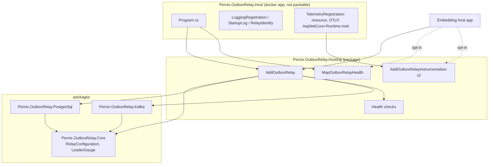
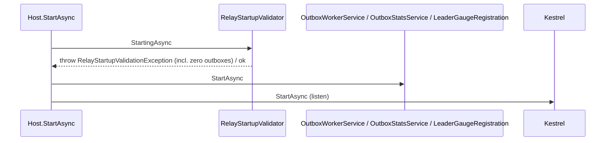

# Design: Embeddable relay hosting package

**Spec ID:** 2026-11-21-embeddable-relay
**Requirements:** [requirements.md](./requirements.md)

## Overview

New project `src/Pernix.OutboxRelay.Hosting` (packable, net10.0) owns all relay DI composition: Core + PostgreSql + Kafka + health checks + `LeaderGaugeRegistration`. Opt-in helpers map `/livez` `/readyz` and add relay source/meter to host OTel builders. `Pernix.OutboxRelay.Host` shrinks to host-owned concerns and calls same Hosting entry points. Relay config scoped to `OutboxRelay` section through one Core type, `RelayConfiguration`, injected where root `IConfiguration` is read today.

## Code Reuse Analysis

### Existing Components to Leverage
- **`AddOutboxRelayCore`, `AddPostgreSqlOutboxProvider`, `AddKafkaTransport`**: called unchanged by `AddOutboxRelay`. No registration logic duplicated.
- **`HostLifetimeReadinessCheck`, `OutboxDatabaseReadinessCheck`, `WorkerLoopLivenessCheck`**: moved as-is Host -> Hosting (`Health/`). Bodies unchanged.
- **`HealthRegistration.AddRelayHealth` / `MapRelayHealth`**: bodies reused as `AddOutboxRelay` health part and `MapOutboxRelayHealth`. Same names, tags, predicates, default response writer.
- **`LeaderGauge`, `LeaderGaugeRegistration`**: moved as-is Host -> Core `Diagnostics/`. Already depend only on Core (`RelayDiagnostics.Meter`, `OutboxRuntimeState`). Static registry already supports several hosts per process.
- **`RelayOptionsBinder.Bind(IConfiguration)`**: unchanged. Receives `OutboxRelay` section (`IConfigurationSection : IConfiguration`), so `GetSection("Outboxes")` etc. resolve section-relative.
- **`ConfigurationExtensions.GetConnectionString(IConfiguration, name)`**: reads `GetSection("ConnectionStrings")[name]`. Called on `OutboxRelay` section, resolves `OutboxRelay:ConnectionStrings:<name>` with no root fallback (Req3 AC2-3) for free.
- **`RelayConfigurationValidator`**: gains the at-least-one-outbox rule (D5). Existing undefined-destination rule and `RelayStartupValidator` destination probe unchanged. Failure flows through existing `RelayStartupValidationException`, so image log/exit path and test capture unchanged.
- **`RelayFactory` (integration)**, `PostgreSqlFixture`, `KafkaFixture`, `ReadinessTests` pause technique: reused by parity tests.
- **`client/PackageVersion.props` pattern**: mirrored as `src/RelayPackage.props` for relay package version + metadata.

### Integration Points
- **Host configuration**: package reads only `IConfiguration.GetSection("OutboxRelay")` and `IOptions<HostOptions>`.
- **Host health**: relay checks join host's `HealthCheckService`; any host endpoint mapping all checks includes them.
- **Host OTel**: helper extensions on `TracerProviderBuilder` / `MeterProviderBuilder` (OpenTelemetry.Api types). Host owns provider, resource, exporters.
- **Dockerfile**: restore stage copies new Hosting csproj (+ `src/RelayPackage.props`, `.version`). Runtime contract unchanged (NG7).

## Architecture



Startup order (both hosts): all `IHostedLifecycleService.StartingAsync` run in registration order before any `StartAsync` (Kestrel starts in `GenericWebHostService.StartAsync`). `RelayStartupValidator` is the only relay validation step, identical in image and package.



### Decisions
- **D1. Section scoping via `RelayConfiguration` type, not keyed `IConfiguration`.** Consumers (`RelayStartupValidator`, `PostgreSqlOutboxStoreProvider`) take `RelayConfiguration` instead of root `IConfiguration`. Explicit, unit-testable with plain `ConfigurationBuilder().Build()` (section-relative keys), no ambiguity with host root.
- **D2. `OutboxRelay.` path prefix applied centrally in `RelayStartupValidator`.** Every failure from config, store, probe, bounds stages gets `OutboxRelay.` prepended before `RelayStartupValidationException` thrown. `HostOptions.ShutdownTimeout` failure stays unprefixed (root, host-owned). `RelayConfigurationValidator`, binder, providers, transports keep section-relative paths, so their unit tests stay unchanged. Runtime messages (`Outboxes[x]: session lost`, `stats unavailable`, logs) stay unprefixed: they name outboxes, not settings.
- **D3. Duplicate registration detected by `ValidatedOutboxes` descriptor.** `AddOutboxRelay` throws `InvalidOperationException` if `services` already has a `ValidatedOutboxes` descriptor (only `AddOutboxRelayCore` registers it). Catches `AddOutboxRelay` twice and `AddOutboxRelayCore` + `AddOutboxRelay`. Check runs before any registration, so nothing duplicated.
- **D4. `LeaderGaugeRegistration` registered in `AddOutboxRelayCore`.** Moves to Core with `LeaderGauge`; any Core composition reports `outbox.leader`. Hosting gets it through Core (Req1 AC3).
- **D5. Zero outboxes is a Core config failure, in image and package.** `RelayConfigurationValidator.Validate` adds section-relative `Outboxes: at least one outbox is required` when `options.Outboxes.Count == 0`. `RelayStartupValidator` prefixes it (D2) to `OutboxRelay.Outboxes: at least one outbox is required` and throws in the configuration stage, before store and probe stages. `NoOutboxesConfigured` (EventId 100, `LeadershipLog`) and its call in `RelayStartupValidator` are deleted. No root-level key inspection anywhere: an un-migrated image binds an empty `OutboxRelay` section and fails on this rule. Human ruling 2026-11-22, supersedes the image-only legacy guard.
- **D6. Telemetry helpers depend on `OpenTelemetry.Api` only.** `TracerProviderBuilder.AddSource` and `MeterProviderBuilder.AddMeter` are API members. No SDK, exporter or instrumentation package in Hosting.
- **D7. Packages: Core, PostgreSql, Kafka, Hosting each packable, separate packages.** Keeps NuGet graph honest (Kafka native deps flow from Kafka package), matches project graph. No bundling.
- **D8. Version from `.version`.** `src/RelayPackage.props` sets `VersionPrefix` from repo-root `.version` (`1.0` -> NuGet `1.0.0`). CI overrides with `-p:Version=$(BUILD_VERSION)` so packages equal image version. CI job itself is NG8.

## Components and Interfaces

### C1. `RelayConfiguration` (Core, new)
- **Purpose:** carry relay config section.
- **Interfaces:**
  ```csharp
  namespace Pernix.OutboxRelay.Core.Configuration;
  public sealed class RelayConfiguration(IConfiguration section)
  {
      public const string SectionName = "OutboxRelay";
      public IConfiguration Section { get; } = section;
  }
  ```
- **Registration:** `AddOutboxRelayCore` adds `TryAddSingleton(sp => new RelayConfiguration(sp.GetRequiredService<IConfiguration>().GetSection(RelayConfiguration.SectionName)))`. `TryAdd` lets tests substitute.
- **Consumers changed:**
  - `RelayStartupValidator(RelayConfiguration configuration, ...)`: `RelayOptionsBinder.Bind(configuration.Section)`, `configuration.Section.GetConnectionString`. Prefixes failures (D2) via private `Prefixed(IEnumerable<string>)` => `$"{SectionName}.{f}"`.
  - `PostgreSqlOutboxStoreProvider(RelayConfiguration configuration)`: `configuration.Section.GetConnectionString(connectionName)`.
- **Message text change:** `RelayConfigurationValidator` connection failure `... is not defined or empty in ConnectionStrings` -> `... in OutboxRelay.ConnectionStrings`.
- **New rule (D5):** `RelayConfigurationValidator` zero-outbox failure, see C6.

### C2. `LeaderGauge`, `LeaderGaugeRegistration` (Core, moved)
- **Path:** `src/Pernix.OutboxRelay.Core/Diagnostics/`. Namespace `Pernix.OutboxRelay.Core.Diagnostics`. Bodies unchanged.
- **Registration:** `AddOutboxRelayCore` adds `AddHostedService<LeaderGaugeRegistration>()` (D4). Removed from `TelemetryRegistration`.

### C3. `OutboxRelayServiceCollectionExtensions` (Hosting, new)
- **Interfaces:**
  ```csharp
  namespace Pernix.OutboxRelay.Hosting;
  public static class OutboxRelayServiceCollectionExtensions
  {
      public static IServiceCollection AddOutboxRelay(this IServiceCollection services);
      public static TBuilder AddOutboxRelay<TBuilder>(this TBuilder builder) where TBuilder : IHostApplicationBuilder; // => builder.Services.AddOutboxRelay(); return builder;
  }
  ```
- **`AddOutboxRelay(IServiceCollection)` body:** null check; D3 guard (`InvalidOperationException("AddOutboxRelay was already called on this service collection.")`); `AddOutboxRelayCore().AddPostgreSqlOutboxProvider().AddKafkaTransport()`; `AddHealthChecks()` + three checks (names/tags from C4).
- **Does not touch:** logging, OTel, Kestrel, endpoints, `HostOptions` (Req1 AC4-5).

### C4. Health (Hosting, moved + renamed constants)
- **Path:** `src/Pernix.OutboxRelay.Hosting/Health/`. Namespace `Pernix.OutboxRelay.Hosting.Health` for check classes.
- **Constants** (renamed from generic `HealthTags`/`HealthPaths` to avoid host-namespace collisions):
  ```csharp
  public static class OutboxRelayHealthChecks
  {
      public const string LiveTag = "live", ReadyTag = "ready";
      public const string HostLifetime = "host-lifetime", OutboxDatabase = "outbox-database", WorkerLoop = "worker-loop";
      public const string LivePath = "/livez", ReadyPath = "/readyz";
      public static readonly IReadOnlySet<string> Paths; // OrdinalIgnoreCase { LivePath, ReadyPath }
  }
  ```
- **`OutboxRelayEndpointRouteBuilderExtensions.MapOutboxRelayHealth(this IEndpointRouteBuilder endpoints)`**: two `MapHealthChecks` calls, predicates by tag, default writer. Returns `endpoints`.

### C5. `OutboxRelayTelemetryExtensions` (Hosting, new)
- ```csharp
  public static TracerProviderBuilder AddOutboxRelayInstrumentation(this TracerProviderBuilder builder) => builder.AddSource(RelayDiagnostics.Name);
  public static MeterProviderBuilder AddOutboxRelayInstrumentation(this MeterProviderBuilder builder) => builder.AddMeter(RelayDiagnostics.Name);
  ```
- **Dependencies:** `OpenTelemetry.Api` (`$(OpenTelemetryVersion)`, new `PackageVersion` entry).

### C6. Startup config rules (Core, changed)
- **`RelayConfigurationValidator.Validate`:** first check, `options.Outboxes.Count == 0` -> failure `Outboxes: at least one outbox is required`. Other checks still run, so all config failures are reported together.
- **Kept:** `Outboxes[<o>].Destination: destination '<d>' is not defined in Destinations` for undefined destination references. `RelayStartupValidator` still probes every configured destination at startup.
- **`RelayStartupValidator`:** delete `NoOutboxesConfigured` call and the "no early return" zero-outbox branch. Prefix (D2) yields `OutboxRelay.Outboxes: at least one outbox is required`.
- **`LeadershipLog.NoOutboxesConfigured`** (EventId 100): deleted.
- **Applies to:** image and package, via `AddOutboxRelayCore`. No Host-only validation type.

### C7. `Program.cs` (Host, thinned)
```csharp
var builder = WebApplication.CreateBuilder(args);
var identity = RelayIdentity.From(builder.Configuration);
builder.Services.Configure<HostOptions>(builder.Configuration.GetSection("HostOptions"));
builder.AddRelayLogging();
builder.AddOutboxRelay();
builder.AddRelayTelemetry(identity);                          // + .AddOutboxRelayInstrumentation() on both builders; trace filter uses OutboxRelayHealthChecks.Paths
var app = builder.Build();
app.MapOutboxRelayHealth();
// RelayStarting log, RunAsync, catch -> StartupFailed, return 1: unchanged
```
- Deleted from Host: `Health/` folder, `Telemetry/LeaderGauge*.cs`, `Configuration/LegacyConfigurationGuard.cs`, Host `InternalsVisibleTo` for the unit test assembly (only served the guard). Host `.csproj` adds `ProjectReference` Hosting, drops Core/PostgreSql/Kafka direct refs (transitive). This `ProjectReference` set stays unchanged in this revision (human question pending). Keeps OTel SDK/exporter/instrumentation packages.

### C8. Packaging
- **`src/RelayPackage.props` (new):** `IsPackable=true`, `VersionPrefix=$([System.IO.File]::ReadAllText('$(MSBuildThisFileDirectory)../.version').Trim())`, `Authors`, `RepositoryUrl`, `RepositoryType`, `PackageTags` (as `client/Directory.Build.props`), `PackageReadmeFile` not required. Imported by Core, PostgreSql, Kafka, Hosting csproj.
- **Hosting csproj:** `Microsoft.NET.Sdk`, `FrameworkReference Microsoft.AspNetCore.App` (emitted as nuspec `frameworkReferences`, Req6 AC4), `PackageReference OpenTelemetry.Api`, `ProjectReference` Core/PostgreSql/Kafka (become package deps at pack).
- **Native assets:** Kafka package deps `Confluent.Kafka` 2.16.0 + `Nanov.Kafka [2.16.0.3]` carry `librdkafka.redist` transitively (Req6 AC3). Verified by inspecting packed `.nuspec` + restore of a consumer project (Testing).
- **Solution/Docker:** `OutboxRelay.slnx` adds Hosting under `/src/`. Dockerfile restore stage adds `COPY` for `src/Pernix.OutboxRelay.Hosting/Pernix.OutboxRelay.Hosting.csproj`, `src/RelayPackage.props`, `.version`.

### C9. Documentation
- **`docs/embedding.md` (new):** install, `AddOutboxRelay`, `MapOutboxRelayHealth`, `AddOutboxRelayInstrumentation`, config under `OutboxRelay`, what package does not touch, host implications (Req8 AC3 list).
- **`README.md`:** two delivery forms, minimal embedding snippet, link to `docs/embedding.md`.
- **`docs/configuration.md`:** all keys/examples/env vars under `OutboxRelay`; new "Migrating from root-level settings" section (mapping table below; un-migrated image fails with `OutboxRelay.Outboxes: at least one outbox is required`; relay does no key-by-key legacy detection, so root keys left behind are ignored, not reported). Migration covers every config source in ADR 0002 layering (appsettings, SSM Parameter Store, Helm env, command line), not only appsettings/env.
- **`docs/runbook.md`, `docs/runbook-appsettings.example.json`:** `OutboxRelay` section, `OutboxRelay__ConnectionStrings__Main`, upgrade note covering SSM paths and Helm values (per mapping table) and stating an un-migrated image fails startup with `OutboxRelay.Outboxes: at least one outbox is required`. No key-by-key legacy detection.
- **`docs/product.md`:** "ships only as an image" -> image and `Pernix.OutboxRelay.Hosting` package. Startup messages in `docs/configuration.md` § Startup validation shown with `OutboxRelay.` prefix.

## Data Models

### Config shape (both hosts)
```
OutboxRelay
  ConnectionStrings: { <name>: string }
  KafkaClusters:     { <name>: { BootstrapServers, Producer: {...} } }
  Destinations:      [ { Name, Transport, Kafka: {...} } ]
  Outboxes:          [ { Name, Destination, Database: { Provider, Connection, Table }, Polling, Retry, DeadLetter, Ordering } ]
HostOptions                       # root, host-owned
  ShutdownTimeout >= 00:00:28
```
Element models (`RelayOptions`, `OutboxOptions`, `DestinationOptions`, `KafkaClusterOptions`) unchanged.

### Migration mapping (image)
| Before | After |
|---|---|
| `Outboxes`, `Destinations`, `KafkaClusters` | `OutboxRelay:Outboxes`, `OutboxRelay:Destinations`, `OutboxRelay:KafkaClusters` |
| `ConnectionStrings:<name>` (relay) | `OutboxRelay:ConnectionStrings:<name>` |
| env `Outboxes__0__Polling__BatchSize` | env `OutboxRelay__Outboxes__0__Polling__BatchSize` |
| env `ConnectionStrings__Main` | env `OutboxRelay__ConnectionStrings__Main` |
| SSM path `.../Outboxes/0/...`, `.../Destinations/...`, `.../KafkaClusters/...`, `.../ConnectionStrings/<name>` | SSM path `.../OutboxRelay/Outboxes/0/...`, `.../OutboxRelay/Destinations/...`, `.../OutboxRelay/KafkaClusters/...`, `.../OutboxRelay/ConnectionStrings/<name>` |
| Helm values env keys `Outboxes__*`, `Destinations__*`, `KafkaClusters__*`, `ConnectionStrings__*` | Helm values env keys `OutboxRelay__Outboxes__*`, `OutboxRelay__Destinations__*`, `OutboxRelay__KafkaClusters__*`, `OutboxRelay__ConnectionStrings__*` |
| command line `--Outboxes:0:...` | command line `--OutboxRelay:Outboxes:0:...` |
| `HostOptions`, `Kestrel`, `Logging`, `SERVICE_*`, `OTEL_*` | unchanged |

## Error Handling

### Error Scenarios
1. **Invalid relay config (any stage).**
   - **Handling:** `RelayStartupValidator` throws `RelayStartupValidationException`, lines prefixed `OutboxRelay.` (D2).
   - **User Impact:** image: `StartupFailed`, exit `1`. Embedded: host `StartAsync` throws, host app process start fails (documented).
2. **No outboxes configured (image or package), including image started with pre-migration config.**
   - **Handling:** `RelayConfigurationValidator` fails `OutboxRelay.Outboxes: at least one outbox is required` in configuration stage (D5). Root keys are not inspected.
   - **User Impact:** image: `StartupFailed`, exit `1`. Embedded: host start fails. Migration docs name this message as the un-migrated-image symptom.
3. **Outbox references undefined destination.**
   - **Handling:** existing failure `OutboxRelay.Outboxes[<o>].Destination: destination '<d>' is not defined in Destinations`, unchanged rule, prefixed per D2. Defined destinations probed at startup.
   - **User Impact:** `StartupFailed`, exit `1` (image) or host start fails (embedded).
4. **`AddOutboxRelay` called twice / mixed with `AddOutboxRelayCore`.**
   - **Handling:** `InvalidOperationException` at registration (D3).
   - **User Impact:** fails at composition, before host build.
5. **Embedded host `HostOptions.ShutdownTimeout < 00:00:28`.**
   - **Handling:** existing validator failure, unprefixed `HostOptions.ShutdownTimeout: ...`.
   - **User Impact:** host start fails; docs tell host to raise timeout. Default 30 s passes.
6. **Missing `OutboxRelay:ConnectionStrings:<name>` while root `ConnectionStrings:<name>` set (embedded).**
   - **Handling:** config failure `OutboxRelay.Outboxes[<o>].Database.Connection: connection string '<name>' is not defined or empty in OutboxRelay.ConnectionStrings`. No fallback.
   - **User Impact:** explicit message points at relay section.

## Testing Strategy

### Unit Testing
- **Hosting registration (`tests/Pernix.OutboxRelay.Unit.Tests/Hosting/`):** `AddOutboxRelay` registers `RelayStartupValidator`, `OutboxWorkerService`, `OutboxStatsService`, `LeaderGaugeRegistration` hosted services, `IOutboxStoreProvider` PostgreSql, `IDestinationFactory` Kafka, three health checks with names/tags (via `IOptions<HealthCheckServiceOptions>`). Second call throws `InvalidOperationException`; descriptor count unchanged. `AddOutboxRelayCore` then `AddOutboxRelay` throws. No added descriptor of `ILoggerProvider`, `TracerProvider`, `MeterProvider`, `IConfigureOptions<KestrelServerOptions>`, `IConfigureOptions<LoggerFilterOptions>`.
- **Telemetry helpers:** OTel SDK `Sdk.CreateTracerProviderBuilder().AddOutboxRelayInstrumentation()` listens to `RelayDiagnostics.ActivitySource`; meter equivalent via in-memory exporter (`OpenTelemetry.Exporter.InMemory`, already central).
- **`RelayConfigurationValidator` zero outboxes (new):** empty `Outboxes` -> failure `Outboxes: at least one outbox is required`; one outbox with defined destination -> no such failure; zero outboxes plus other config errors -> all reported.
- **Deleted:** `LegacyConfigurationGuardTests`.
- **`RelayStartupValidator`:** prefix applied to every stage; `HostOptions` line unprefixed; connection lookup section-only (root-only string fails). Zero-outbox tests that expected the EventId 100 warning or probing with no outboxes (`No_outboxes_*` in `RelayStartupValidatorTests`) now assert `OutboxRelay.Outboxes: at least one outbox is required` and no probe.
- **`PostgreSqlOutboxStoreProvider`:** reads `RelayConfiguration.Section`.
- **Moved tests:** `Health/*Tests`, `Telemetry/LeaderGaugeTests` change `using` only. Unit test csproj adds Hosting `ProjectReference` (keeps Host for `RelayIdentityTests`).
- **Existing validator/binder tests:** unchanged (section-relative, D2). `RunbookExampleTests` binds `OutboxRelay` section of updated example.

### Integration Testing
- **Existing suite migration:** `RelayFactory.WithRelaySettings` prefixes keys whose first segment is `Outboxes`, `Destinations`, `KafkaClusters` or `ConnectionStrings` with `OutboxRelay:`; other keys pass through. Assertions on startup messages in `StartupValidationTests` updated to prefixed text. `StatsMetricsTests` `using` -> Core namespace.
- **New `Embedded/EmbeddedHostParityTests`:**
  - Sample web host in test code: `WebApplication.CreateBuilder()`, `WebHost.UseTestServer()`, settings via in-memory `OutboxRelay:*`, `builder.AddOutboxRelay()`, `app.MapOutboxRelayHealth()`. Not `Program`.
  - Delivery parity: same outbox row shape inserted for embedded host and for `RelayFactory` host (separate schemas, same topic fixture); consumed records compared on key, payload, headers (Req7 AC2).
  - Health parity: both hosts `/livez` 200 `/readyz` 200 when healthy; own PostgreSQL container paused (`ReadinessTests` technique) -> both `/readyz` 503, `/livez` 200 (Req7 AC3).
  - Invalid config: embedded host `StartAsync` throws `RelayStartupValidationException` with `OutboxRelay.`-prefixed line (Req7 AC4).
- **New generic-host test:** `Host.CreateApplicationBuilder()` + `AddOutboxRelay()` delivers one row (no ASP.NET endpoint mapped) -> proves Req2 AC2 / Req1 AC5 path.
- **Zero outboxes (new):** `RelayFactory` with empty `OutboxRelay` section -> start fails with `OutboxRelay.Outboxes: at least one outbox is required`; image `Program` returns exit `1` with `StartupFailed`.
- **Tests that started with zero outboxes** (e.g. `RelayFactory()` without outbox settings in `StartupLogTests`, `TracingTests`, `HealthEndpointTests`, `LogSecrecyTests`, `ReadinessTests`, `StartupValidationTests`): add a minimal valid outbox + destination, or assert the new failure where start failure is the subject.
- **Deleted:** `LegacyConfigurationTests`, `RelayFactory.WithRootSettings` if unused.

### End-to-End Testing
- `dotnet pack -c Release` produces 4 nupkgs (`Pernix.OutboxRelay.Core`, `.PostgreSql`, `.Kafka`, `.Hosting`), all version = `.version`, `lib/net10.0`, Hosting nuspec has `frameworkReferences Microsoft.AspNetCore.App` and deps on the three libraries + `OpenTelemetry.Api`; Kafka nuspec depends on `Confluent.Kafka` / `Nanov.Kafka`. Host not packed.
- `docker build` succeeds; container with migrated `docs/runbook-appsettings.example.json`-shaped config starts and serves `/livez` on 5612 (manual/CI smoke, existing image checks).

## Links

- ADRs: [0002](../../adr/0002-load-ssm-config-once-below-env-vars.md) (config layering, unchanged), [0003](../../adr/0003-leadership-by-postgresql-session-advisory-lock.md) (leadership unchanged across embedded replicas), [0008](../../adr/0008-producer-client-packages.md) (client packaging precedent).
- New ADR(s) at closeout in `docs/adr/`: D1 (`RelayConfiguration` section scoping under `OutboxRelay`), D3 (duplicate registration throws), D7 (four packable packages; relay ships as image and package). D1 ADR cross-references ADR 0002 (all layered sources move under `OutboxRelay`). D7 ADR cross-references ADR 0008 (packaging precedent, separate version lines).
- ADR 0011 (`docs/adr/0011-relay-config-section-and-hosting-package.md`) revision: drop D5 (legacy guard) and its rejected alternatives. Record new rule: at least one outbox required in Core, image and package, `OutboxRelay.Outboxes: at least one outbox is required`. No root-level key detection.
- Related specs: none.
- Architecture docs: [outbox-relay-host.md](../../architecture/outbox-relay-host.md) (update at closeout: Hosting component, moved types, `OutboxRelay` section).
