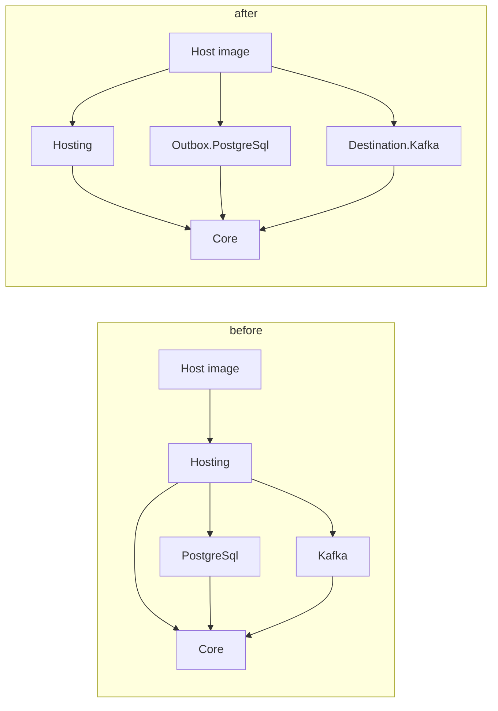
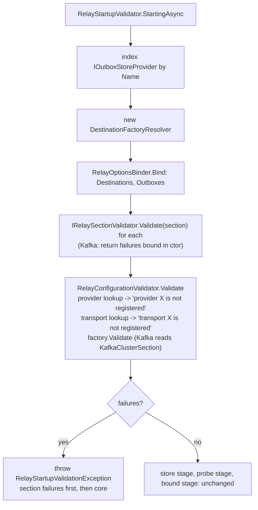

# Design: Lean Hosting package and role-named provider packages

**Spec ID:** 2026-11-22-lean-hosting
**Requirements:** [requirements.md](./requirements.md)

## Overview

Base `be8df1f`. Three moves, one PR:

1. **Rename.** `src/Pernix.OutboxRelay.PostgreSql` -> `src/Pernix.OutboxRelay.Outbox.PostgreSql`, `src/Pernix.OutboxRelay.Kafka` -> `src/Pernix.OutboxRelay.Destination.Kafka` (dir, csproj, assembly, root namespace, package id). `git mv`, then namespace/`using` rewrite.
2. **Lean Hosting.** `AddOutboxRelay()` = `AddOutboxRelayCore()` + 3 health checks. Hosting csproj drops both provider `ProjectReference`s. Providers register themselves via `AddPostgreSqlOutbox()` / `AddKafkaDestination()`.
3. **Kafka config out of Core.** `KafkaClusterOptions`, `RelayOptions.KafkaClusters`, `KafkaClusters` binding move to `Destination.Kafka`. Core gains one provider-agnostic hook, `IRelaySectionValidator`, so a provider binds/validates its own root key under `OutboxRelay` in the configuration stage.

Image (`Pernix.OutboxRelay.Host`) references Hosting + both providers, calls the full chain. Config shape, validation stages, messages (except Q4), health, metrics, traces, exit codes unchanged.

## Resolved decisions (requirements rulings, foreman-approved 2026-11-22)

- **Q1.** Accept Kafka logger category change: `Pernix.OutboxRelay.Kafka.KafkaDestinationFactory` -> `Pernix.OutboxRelay.Destination.Kafka.KafkaDestinationFactory`. No pinned old category string. `docs/configuration.md` documents new key `Logging:LogLevel:Pernix.OutboxRelay.Destination.Kafka`. ADR 0012 records it.
- **Q2.** Provider/destination registration idempotent via `TryAddEnumerable`. Repeat call adds nothing, startup unaffected.
- **Q3.** Provider registration without `AddOutboxRelay()` allowed, no check. Services sit unused.
- **Q4.** Unregistered transport message: `OutboxRelay.Destinations[<name>].Transport: transport '<value>' is not registered`.

## Design decisions

- **D1. Registration method names: `AddPostgreSqlOutbox`, `AddKafkaDestination`.** Role suffix per Req2 AC6. Old `AddPostgreSqlOutboxProvider` / `AddKafkaTransport` deleted, no alias (NG2).
- **D2. Chaining by extension methods on `IServiceCollection` and `TBuilder : IHostApplicationBuilder`, no relay builder type.** `AddOutboxRelay` keeps return types (`IServiceCollection`, `TBuilder`). Each provider package adds the same two overloads. `builder.AddOutboxRelay().AddPostgreSqlOutbox().AddKafkaDestination()` and `services.AddOutboxRelay().AddPostgreSqlOutbox().AddKafkaDestination()` both compile. Rejected: `IOutboxRelayBuilder` returned from `AddOutboxRelay` (ASP.NET `IHealthChecksBuilder` style). It adds a public Core type, breaks `builder.AddOutboxRelay()` returning `TBuilder` (`Builder_overload_registers_on_builder_services`), and contradicts Q3 (provider registration only reachable through the relay builder).
- **D3. Extension classes stay in package namespace.** `Pernix.OutboxRelay.Outbox.PostgreSql.PostgreSqlOutboxServiceCollectionExtensions`, `Pernix.OutboxRelay.Destination.Kafka.KafkaDestinationServiceCollectionExtensions`. Matches Hosting (`Pernix.OutboxRelay.Hosting`). Embedder adds one `using` per package.
- **D4. Provider-owned root keys via `IRelaySectionValidator` (Core.Abstractions).** Kafka binds `OutboxRelay:KafkaClusters` itself, once, from Core's `RelayConfiguration` singleton, and reports failures in configuration stage. `IDestinationFactory.Validate(DestinationOptions, string, RelayOptions)` signature unchanged. `RelayOptions` keeps `Destinations`, `Outboxes` (dead-letter mapping) and loses `KafkaClusters`. Satisfies Req4 AC5: destination options, path, outboxes via `RelayOptions`, relay section via `IRelaySectionValidator.Validate(IConfiguration)`. Rejected: Kafka factory binding `KafkaClusters` inside each `Validate` call. Failures for one cluster would repeat per Kafka destination, and failures for clusters no destination names would vanish (message set changes, Req4 AC3).
- **D5. `KafkaClusterSection` is immutable: binds in its constructor, factory reads it.** Internal sealed singleton in `Destination.Kafka`, implements `IRelaySectionValidator`. Constructor takes `RelayConfiguration`, binds `KafkaClusters` from `RelayConfiguration.Section` once, stores the cluster dictionary and the failure list in `readonly` fields. `Validate(section)` returns the stored failures and ignores its argument (same `RelayConfiguration.Section` instance `RelayStartupValidator` passes). `TryGet` reads the stored dictionary. No mutable state, so the factory sees the same clusters whether or not, or in which order, `Validate` runs. `KafkaDestinationFactory` takes the section by constructor. Factory constructors become `internal`. Registration uses factory-lambda descriptors (D6). Binding never throws (`BindSection` collects failures), so construction during DI resolution cannot fail outside the configuration-stage report.
- **D6. DI shape of `AddKafkaDestination`.**
  ```csharp
  services.TryAddSingleton(sp => new KafkaClusterSection(sp.GetRequiredService<RelayConfiguration>()));
  services.TryAddEnumerable(ServiceDescriptor.Singleton<IRelaySectionValidator, KafkaClusterSection>(
      sp => sp.GetRequiredService<KafkaClusterSection>()));
  services.TryAddEnumerable(ServiceDescriptor.Singleton<IDestinationFactory, KafkaDestinationFactory>(
      sp => new KafkaDestinationFactory(sp.GetRequiredService<ILoggerFactory>(), sp.GetRequiredService<KafkaClusterSection>())));
  ```
  `RelayConfiguration` comes from `AddOutboxRelayCore` (`TryAddSingleton`). Without `AddOutboxRelay()` the Kafka services stay registered but are never resolved (Q3), so the missing dependency never surfaces. `TryAddEnumerable` dedupes factory descriptors by `TImplementation` from the `Func<>` type argument, so a repeat call adds nothing (Q2). `AddPostgreSqlOutbox` keeps today's `TryAddEnumerable(ServiceDescriptor.Singleton<IOutboxStoreProvider, PostgreSqlOutboxStoreProvider>())` plus `ArgumentNullException.ThrowIfNull(services)`.
- **D7. `DestinationFactoryResolver` duplicate-transport throw stays.** Two distinct factories claiming one transport remains a composition bug. Idempotent registration (D6) means a repeat `AddKafkaDestination()` never reaches it.
- **D8. Per-package `PackageTags`.** `src/RelayPackage.props` sets `outbox;transactional-outbox`. `Outbox.PostgreSql` appends `postgresql`, `Destination.Kafka` appends `kafka`. Core and Hosting keep base tags only (Req7 AC6).
- **D9. Lean-registration startup test runs in unit suite.** Unregistered provider/transport fails in configuration stage, before any database or broker call, so no container needed.

## Code Reuse Analysis

### Existing Components to Leverage
- **`OutboxRelayCoreServiceCollectionExtensions.AddOutboxRelayCore`**: sole relay registration in lean `AddOutboxRelay`. Unchanged.
- **`AddOutboxRelay` D3 guard** (`ValidatedOutboxes` check): unchanged, still first statement.
- **`RelayConfigurationValidator.DatabaseReferences`**: already emits `provider '<value>' is not registered`. Req3 AC1 needs no change.
- **`DestinationFactoryResolver.Resolve`**: one string change (Q4).
- **`RelayConfiguration`** (public singleton, Core): `KafkaClusterSection` constructor source for the `OutboxRelay` section. Shape unchanged (`Section`, `SectionName`).
- **`RelayOptionsBinder.BindSection<T>`** (public, Core): Kafka reuses it for `KafkaClusters[<name>]`, so failure text (unknown setting, convert failure, value-free) stays byte-identical.
- **`RelayStartupValidator.Prefixed`**: adds `OutboxRelay.` to section-validator failures like all other configuration-stage failures.
- **`RelayStartupValidationException`, `StartupFailed` log + exit 1**: unchanged, cover Req3 AC3/AC4.
- **`PostgreSqlServiceCollectionExtensions` `TryAddEnumerable` pattern**: copied to Kafka (Q2).
- **`OutboxRelayRegistrationTests`, `PackageGraphTests`, `RelayOptionsBinderTests` Kafka cases, `StartupValidationTests`, `RunbookExampleTests`, `LogSecrecyTests`**: extended or retargeted, not rewritten.

### Integration Points
- **`RelayStartupValidator.StartingAsync`**: new ctor parameter `IEnumerable<IRelaySectionValidator> sectionValidators`. Runs them before `RelayConfigurationValidator.Validate`, prepends their failures.
- **`KafkaDestinationFactory.Validate`**: cluster lookup moves from `relay.KafkaClusters` to `KafkaClusterSection.TryGet`.
- **`Pernix.OutboxRelay.Host/Program.cs`**: `builder.AddOutboxRelay().AddPostgreSqlOutbox().AddKafkaDestination();`
- **`Dockerfile`**: two `COPY` csproj lines renamed.
- **`OutboxRelay.slnx`**, test + benchmark csproj `ProjectReference`s, `AssemblyInfo.cs` `InternalsVisibleTo` (moves with Kafka project, content unchanged; PostgreSql has none today).

## Architecture

### Package graph



Rules: no provider -> Hosting, no provider -> provider, Hosting -> Core only. Third-party deps: `Outbox.PostgreSql` -> `Npgsql`, `Dapper`. `Destination.Kafka` -> `Confluent.Kafka`, `Nanov.Kafka` `[2.16.0.3]` (transitively `librdkafka.redist`). Hosting -> `OpenTelemetry.Api`, ASP.NET Core framework ref.

### Configuration stage (startup)



`KafkaClusterSection` binds when DI first resolves it, which is when the host resolves `RelayStartupValidator` (it takes `IEnumerable<IRelaySectionValidator>` and `IEnumerable<IDestinationFactory>`), before `StartingAsync`. Config is read once either way, as today (`RelayOptionsBinder.Bind` runs once per `StartingAsync`).

Failure order preserved: today `BindingFailures` = `KafkaClusters` failures, then `Outboxes` failures, then the rest. New order: section-validator failures, then Core `BindingFailures`, then the rest. Core's "reported once, by the binder" filter (`boundPaths`) only matches Core paths; `KafkaClusters[...]` paths never collided with Core checks, so no dedupe change.

### Modular Design Principles
- Core names no concrete provider/transport (Req4 AC1). `PostgreSQL` mentions in Core comments (`RelayConfigurationValidator` batch-size comment, `ScopedDelivery`) are rationale for generic limits, not types/members/strings. Kept. Req4 AC1 scopes "type/member/string".
- Each provider owns its registration, its config, its validation.

## Components and Interfaces

### C1. `IRelaySectionValidator` (new, Core)
- **File:** `src/Pernix.OutboxRelay.Core/Abstractions/IRelaySectionValidator.cs`
- **Interface:**
  ```csharp
  namespace Pernix.OutboxRelay.Core.Abstractions;

  // Binds and checks a provider-owned key under the OutboxRelay section in the configuration stage, before any IDestinationFactory.Validate.
  // Failure paths are section-relative and never carry values.
  public interface IRelaySectionValidator
  {
      IReadOnlyList<string> Validate(IConfiguration section);
  }
  ```
- **Dependencies:** `Microsoft.Extensions.Configuration.Abstractions` (Core already uses it).

### C2. `RelayStartupValidator` (changed, Core)
- Primary ctor gains `IEnumerable<IRelaySectionValidator> sectionValidators`.
- Configuration stage:
  ```csharp
  var options = RelayOptionsBinder.Bind(configuration.Section);
  var sectionFailures = sectionValidators.SelectMany(v => v.Validate(configuration.Section)).ToList(); // before factory.Validate
  var failures = sectionFailures
      .Concat(RelayConfigurationValidator.Validate(options, configuration.Section.GetConnectionString, providersByName, resolver))
      .Select(Prefixed)
      .ToList();
  ```
- Rest unchanged.

### C3. `RelayOptions` / `RelayOptionsBinder` (changed, Core)
- `RelayOptions`: remove `KafkaClusters`. Remove `KafkaClusterOptions` class from file.
- `RelayOptionsBinder.Bind`: remove `KafkaClusters` loop. `BindSection<T>` unchanged, stays public.

### C4. `DestinationFactoryResolver` (changed, Core)
- `Resolve` failure text: `$"{path}.Transport: transport '{destination.Transport}' is not registered"` (Q4).

### C5. `OutboxRelayServiceCollectionExtensions` (changed, Hosting)
- Drop `using Pernix.OutboxRelay.Kafka;`, `using Pernix.OutboxRelay.PostgreSql;`.
- `services.AddOutboxRelayCore();` replaces the 3-call chain. Health checks, D3 guard, both overloads unchanged.
- Comment updated: registers relay core + health checks, no outbox provider or destination.
- `Pernix.OutboxRelay.Hosting.csproj`: remove 2 provider `ProjectReference`s.

### C6. `Pernix.OutboxRelay.Outbox.PostgreSql` (renamed project)
- Dir/csproj rename, `<RootNamespace>`/assembly/package id `Pernix.OutboxRelay.Outbox.PostgreSql`. Namespace `Pernix.OutboxRelay.PostgreSql` -> `Pernix.OutboxRelay.Outbox.PostgreSql` in every file.
- `PostgreSqlServiceCollectionExtensions` -> `PostgreSqlOutboxServiceCollectionExtensions`:
  ```csharp
  public static IServiceCollection AddPostgreSqlOutbox(this IServiceCollection services);
  public static TBuilder AddPostgreSqlOutbox<TBuilder>(this TBuilder builder) where TBuilder : IHostApplicationBuilder;
  ```
- `PackageTags`: `$(PackageTags);postgresql`.

### C7. `Pernix.OutboxRelay.Destination.Kafka` (renamed project)
- Dir/csproj rename, `<RootNamespace>`/assembly/package id `Pernix.OutboxRelay.Destination.Kafka`. Namespace rename in every file. `AssemblyInfo.cs` moves unchanged.
- `KafkaServiceCollectionExtensions` -> `KafkaDestinationServiceCollectionExtensions`:
  ```csharp
  public static IServiceCollection AddKafkaDestination(this IServiceCollection services); // D6 body
  public static TBuilder AddKafkaDestination<TBuilder>(this TBuilder builder) where TBuilder : IHostApplicationBuilder;
  ```
- New `KafkaClusterOptions.cs`: class moved from Core, same members, `internal sealed` (only `KafkaClientSettings`, internal, and factory use it).
- New `KafkaClusterSection.cs`:
  ```csharp
  internal sealed class KafkaClusterSection : IRelaySectionValidator
  {
      internal const string Key = "KafkaClusters";
      private readonly Dictionary<string, KafkaClusterOptions> clusters = new(StringComparer.OrdinalIgnoreCase);
      private readonly IReadOnlyList<string> failures;

      public KafkaClusterSection(RelayConfiguration configuration)
      {
          ArgumentNullException.ThrowIfNull(configuration);

          var bindFailures = new List<string>();
          foreach (var cluster in configuration.Section.GetSection(Key).GetChildren())
          {
              clusters[cluster.Key] = RelayOptionsBinder.BindSection<KafkaClusterOptions>(cluster, $"{Key}[{cluster.Key}]", bindFailures);
          }

          failures = bindFailures.Distinct(StringComparer.Ordinal).ToList();
      }

      // Bound once in the constructor from RelayConfiguration.Section, the same section RelayStartupValidator passes.
      public IReadOnlyList<string> Validate(IConfiguration section) => failures;

      internal bool TryGet(string name, [NotNullWhen(true)] out KafkaClusterOptions? cluster) => clusters.TryGetValue(name, out cluster);
  }
  ```
  Same loop, path format, `Distinct`, case-insensitive names as today's Core binder (Req4 AC2/AC3).
- `KafkaDestinationFactory`: both ctors `internal`, take `KafkaClusterSection clusters`. `Validate`: `!clusters.TryGet(kafka.Cluster!, out cluster)`; message unchanged (Req4 AC4). `Validate` still reads `relay.Outboxes` for dead-letter mapping.
- `PackageTags`: `$(PackageTags);kafka`.

### C8. `Pernix.OutboxRelay.Host` (changed)
- csproj: add `ProjectReference` to `Outbox.PostgreSql`, `Destination.Kafka`.
- `Program.cs`: `builder.AddOutboxRelay().AddPostgreSqlOutbox().AddKafkaDestination();` plus 2 `using`s.
- DI graph equals today's (Req2 AC3): same service types/lifetimes. Hosted-service order unchanged (all 4 come from `AddOutboxRelayCore`, providers add no hosted service). Only descriptor difference: Kafka factory is a lambda descriptor, plus `KafkaClusterSection` (lambda, depends on `RelayConfiguration`) + its `IRelaySectionValidator` entry.

### C9. Build/pack plumbing
- `OutboxRelay.slnx`: 2 paths.
- `Dockerfile`: 2 `COPY` lines.
- `src/RelayPackage.props`: comment lists `Core, Outbox.PostgreSql, Destination.Kafka, Hosting`; base `PackageTags` (D8).
- `tests/*/*.csproj`, `benchmarks/Pernix.OutboxRelay.Benchmarks/*.csproj`: `ProjectReference` paths. Unit + Integration test projects keep referencing both providers.

## Data Models

### `RelayOptions` (Core, after)
```
Destinations: List<DestinationOptions>
Outboxes:     List<OutboxOptions>
BindingFailures (internal): List<string>
```

### `KafkaClusterOptions` (Destination.Kafka, internal, shape unchanged)
```
BootstrapServers: string?
Producer: Dictionary<string,string> (Ordinal)
```

Config keys unchanged: `OutboxRelay:KafkaClusters:<cluster>:BootstrapServers`, `...:Producer:<key>`.

## Error Handling

### Error Scenarios
1. **Outbox names unregistered provider** (`AddOutboxRelay()` without `AddPostgreSqlOutbox()`).
   - **Handling:** existing `DatabaseReferences` check.
   - **User Impact:** `OutboxRelay.Outboxes[<name>].Database.Provider: provider 'PostgreSql' is not registered`. Configuration stage, no worker, image exit 1.
2. **Destination names unregistered transport** (no `AddKafkaDestination()`).
   - **Handling:** `DestinationFactoryResolver.Resolve` (C4). `factory.Validate` skipped for that destination.
   - **User Impact:** `OutboxRelay.Destinations[<name>].Transport: transport 'Kafka' is not registered`. Same stage. Scenarios 1 and 2 report together.
3. **`KafkaClusters` present, Kafka not registered.**
   - **Handling:** no section validator reads it. Core binder never reads it.
   - **User Impact:** none from that alone (Req3 AC6). Typically scenario 2 also fires.
4. **`KafkaClusters` binding failure, Kafka registered.**
   - **Handling:** collected by `KafkaClusterSection` constructor, returned by `Validate` -> prefixed by `RelayStartupValidator`.
   - **User Impact:** same text as today, e.g. `OutboxRelay.KafkaClusters[Main]: unknown setting 'BootstrapServer'`. Value-free (via `BindSection`).
5. **Repeat provider/destination registration.**
   - **Handling:** `TryAddEnumerable` (D6).
   - **User Impact:** none.

## Testing Strategy

### Unit Testing (`tests/Pernix.OutboxRelay.Unit.Tests`)
- **`Hosting/OutboxRelayRegistrationTests`**
  - Replace `Registers_postgresql_provider_and_kafka_factory` with `Registers_no_outbox_provider_or_destination_factory`: `AddOutboxRelay()` alone -> no `IOutboxStoreProvider`, no `IDestinationFactory`, no `IRelaySectionValidator` descriptor (Req8 AC3).
  - Add `Startup_without_providers_fails_naming_provider_and_transport`: `Host.CreateEmptyApplicationBuilder`, in-memory valid config (PostgreSql outbox, Kafka destination, `HostOptions:ShutdownTimeout` >= `MinShutdownTimeout`), `AddOutboxRelay()` only. `StartAsync` throws `RelayStartupValidationException`; message contains `provider 'PostgreSql' is not registered` and `transport 'Kafka' is not registered` (Req8 AC4, D9).
  - Add `Hosting_references_no_provider_assembly`: `typeof(OutboxRelayServiceCollectionExtensions).Assembly.GetReferencedAssemblies()` has none starting `Pernix.OutboxRelay.Outbox.` or `Pernix.OutboxRelay.Destination.` (Req8 AC5).
  - Add `Hosting_project_depends_on_core_only`: read unit-test `deps.json` `targets` entry for `Pernix.OutboxRelay.Hosting/*`; its `Pernix.*` dependencies = `Pernix.OutboxRelay.Core` only. Guards csproj-level reference that assembly metadata misses when unused (Req1 AC3).
- **New `Registration/ProviderRegistrationTests`**
  - `AddPostgreSqlOutbox` registers `PostgreSqlOutboxStoreProvider` (`Name` `PostgreSql`). `AddKafkaDestination` resolves one `IDestinationFactory` with `Transport` `Kafka` and one `IRelaySectionValidator`, same instance as the `KafkaClusterSection` the factory holds (Req2 AC1/AC2). Resolution tests register `RelayConfiguration` (via `AddOutboxRelayCore()` or a `TryAddSingleton` over an in-memory section), since `KafkaClusterSection` depends on it.
  - Both called twice -> descriptor count unchanged; full chain called twice for providers + valid config -> `RelayStartupValidator` passes configuration stage (Q2, Req2 AC4).
  - Both callable without `AddOutboxRelay()`, no throw (Q3).
  - Builder overloads return same builder (`Assert.Same`).
  - Full chain DI parity: `AddOutboxRelay().AddPostgreSqlOutbox().AddKafkaDestination()` service types + lifetimes + hosted-service order match a pinned list (Req2 AC3).
- **`Configuration/RelayOptionsBinderTests`**: `KafkaClusters` cases (lines ~66, ~104-120, `[InlineData("KafkaClusters:Main:BootstrapServer", ...)]`) move to new `Kafka/KafkaClusterSectionTests` with same inputs/messages (Req8 AC6). Each case builds `new KafkaClusterSection(new RelayConfiguration(config))` and asserts `Validate(config)` failures and `TryGet` results. Add: `Validate` returns the same failures on repeat calls, and `TryGet` returns bound clusters without any `Validate` call. Core test keeps one case: `KafkaClusters` key is ignored by `RelayOptionsBinder.Bind`.
- **`Configuration/DestinationFactoryResolverTests`**, **`RelayConfigurationValidatorTests`**: expected transport message -> `is not registered` (Q4).
- **`Configuration/RelayStartupValidatorTests`**: ctor call sites pass section validators. Add: section-validator failures prefixed and ordered before Core failures.
- **Kafka tests constructing factory**: each builds its in-memory `IConfiguration` first, then `new KafkaDestinationFactory(logger, new KafkaClusterSection(new RelayConfiguration(config)))` (plus producer-builder delegate where used today). No `Validate` call needed before `factory.Validate`. Assertions unchanged.
  - `KafkaHarness` (`KafkaDestinationTests`, `KafkaDestinationFactoryTests`, `KafkaRecordSizeTests`, `KafkaSendSlotPoolTests`): today builds the factory in its constructor and rebuilds `IConfiguration` in each `Bind()` from a mutable `settings` dictionary. `Factory` becomes lazy: built on first access from the then-current `settings`, and `Bind()` reuses that one `IConfiguration`. `Set`/`Remove` on a `KafkaClusters` key after `Factory` is built throws `InvalidOperationException` so a silent stale cluster cannot pass. Both existing `KafkaClusters` mutations (`Producer_message_max_bytes_limits_size_when_smaller_than_topic`, `harness.Set("KafkaClusters:Main:Producer:acks", "1")`) run before the first `Create`, so no test changes order.
  - `KafkaRawProducerTests`: `Create(factory)` builds a constant config. Hoist that config to a static field and construct the factory from it.
  - Integration `KafkaCoexistenceTests`, `KafkaHeaderParityTests`, `KafkaDestinationIntegrationTests`, `KafkaCoexistenceGateTests`: already bind config before constructing the factory. `Bind` helpers return the config (or the section) alongside `RelayOptions`. `KafkaCoexistenceGateTests` reads `relay.KafkaClusters["Main"]` via `section.TryGet("Main", out var cluster)`.
- **`RunbookExampleTests`**: validates `docs/runbook-appsettings.example.json` with Kafka section validator + factory (Req8 AC7). Reuses its existing `RelayConfiguration` (`relay`): `var kafka = new KafkaClusterSection(relay)`, asserts `kafka.Validate(relay.Section)` and core failures empty, factory built from `kafka`.
- **`PackageGraphTests`**: unchanged, green.
- **`AllocationGuardTests`**: unchanged (no hot-path change).

### Integration Testing (`tests/Pernix.OutboxRelay.Integration.Tests`)
- **`Embedded/EmbeddedRelayHost`, `GenericHostDeliveryTests`**: `builder.AddOutboxRelay().AddPostgreSqlOutbox().AddKafkaDestination()` (Req8 AC2).
- **`RelayFactory`** (image via `WebApplicationFactory<Program>`): unchanged, covers image composition.
- **`Startup/StartupValidationTests`**: Kafka cluster messages unchanged. Unknown-transport expectation -> Q4 text.
- **`LogSecrecyTests`**: unchanged, green (Req4 AC6).
- `using` rewrites only elsewhere.

### End-to-End Testing
- `dotnet pack` on 4 relay projects: exactly `Pernix.OutboxRelay.Core`, `.Hosting`, `.Outbox.PostgreSql`, `.Destination.Kafka` `.nupkg`. Inspect nuspecs: Hosting deps = Core + `OpenTelemetry.Api` (+ framework ref), none of the providers or their third-party deps. Providers depend on Core + own third-party, not Hosting/each other. `Destination.Kafka` lists `Nanov.Kafka` (brings `librdkafka.redist`). Tags per D8. Manual verification step in tasks (Req7).
- Docker build + container smoke test: image starts, logs `KafkaClientLoaded` (Req6 AC4).

## Documentation

- **`README.md`**: package list by role (4), embedding snippet with full chain.
- **`docs/embedding.md`**: packages to reference; chain on `IHostApplicationBuilder` and `IServiceCollection`; `AddOutboxRelay()` alone registers no provider/transport; both failure messages; native `librdkafka` + `Nanov.Kafka` `[2.16.0.3]` pin now on `Pernix.OutboxRelay.Destination.Kafka` (only Kafka users pay it); "loads native librdkafka" scoped to Kafka destination.
- **`docs/architecture/outbox-relay-host.md`**: new package graph (Mermaid above), `KafkaClusters` owned by `Destination.Kafka` via `IRelaySectionValidator`.
- **`docs/configuration.md`**: `Logging:LogLevel:Pernix.OutboxRelay.Destination.Kafka` (Q1). `Database.Provider` `PostgreSql` needs `Pernix.OutboxRelay.Outbox.PostgreSql` registered, `Transport` `Kafka` needs `Pernix.OutboxRelay.Destination.Kafka` registered (image registers both). Unregistered-transport message text (Q4).
- **`docs/runbook.md`**, **`docs/development.md`**, **`benchmarks/Pernix.OutboxRelay.Benchmarks/BASELINE.md`**: old project/namespace names -> new.
- **`docs/adr/0012-lean-hosting-and-role-named-provider-packages.md`** (new): lean Hosting, role naming, explicit registration chain + method names (D1/D2), `IRelaySectionValidator` + Kafka config move (D4), per-package tags, Q1 category change + new logging key, Q4 message. Supersedes ADR 0011 D7 composition clause ("Hosting package ... composes Core, PostgreSQL and Kafka") and D7 package names.
- **`docs/adr/0011-...md`**: status line annotation "Superseded in part (D7) by [0012](./0012-...)" only.
- **`docs/adr/README.md`**: index row for 0012.
- ADR 0005, 0008 and older specs keep old names (history, Req5 AC3).

## Risks

- **R1. Namespace segment `Outbox` / `Destination` shadowing.** New namespaces `Pernix.OutboxRelay.Outbox` and `Pernix.OutboxRelay.Destination` are visible from any `Pernix.OutboxRelay.*` namespace. Repo today has no type named `Outbox` or `Destination` (checked), and `Destination` identifiers in tests are class members (resolved first). Build catches any CS0118. Low.
- **R2. `TryAddEnumerable` with lambda descriptor.** Dedupe relies on implementation type inferred from `Func<IServiceProvider, KafkaDestinationFactory>`. Covered by repeat-registration test. Fallback if it misbehaves: make `KafkaClusterSection` public with internal members and keep factory type-activated.
- **R3. Hidden reliance on `relay.KafkaClusters` in tests.** Compile errors surface all sites. Mechanical.
- **R4. Test harness mutates `KafkaClusters` after the factory exists.** Constructor binding freezes clusters at `KafkaClusterSection` construction. `KafkaHarness` guards this with the lazy `Factory` plus throw-on-late-mutation (Testing Strategy). Other harnesses build config before the factory. Low.

## Open questions

None. Q1-Q4 resolved above.

## Links

- ADRs: [0011](../../adr/0011-relay-config-section-and-hosting-package.md), new 0012
- Related specs: [2026-11-21-embeddable-relay](../2026-11-21-embeddable-relay/)
- Architecture docs: [outbox-relay-host.md](../../architecture/outbox-relay-host.md)
