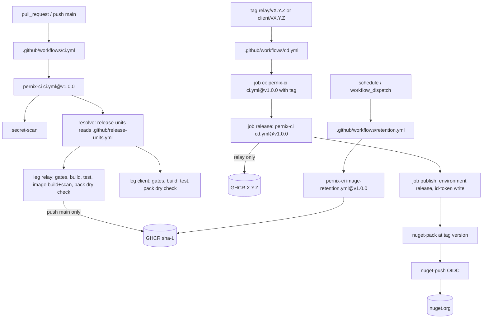

# Design: Adopt pernix-ci CI/CD

**Spec ID:** 2026-11-23-cicd-adoption
**Requirements:** [requirements.md](./requirements.md)

## Overview

Repo gains 4 files under `.github/` copied from pernix-ci `v1.0.0` templates (commit `50c1228ba4f77d3219a270fbf3dcfee7ccf84781`), loses 2 version files, drops 2 platform-cicd workarounds, gains 2 NuGetAudit properties, 1 ADR, doc edits, and 2 repo settings (environment `release`, variable `NUGET_USER`). No C# change. All pipeline logic stays in pernix-ci.

## Decisions

| ID | Decision | Source |
|---|---|---|
| D1 | Pin every pernix-ci line `@v1.0.0` (tag), not sha. README allows `vX.Y.Z` for Trusted Publishing callers. Templates already carry it, so caller files stay template-identical. Tag `v1.0.0` = `50c1228`, recorded in ADR 0013. | Req 6, F11 |
| D2 | Workflows are byte-for-byte template copies except header comments (see C2-C4). No caller-side deviation. | NFR |
| D3 | GHCR image name `pernix-outbox-relay` via `image.name`. Image ref `ghcr.io/pernix-labs/pernix-outbox-relay`. | Q2 resolved (foreman 2026-11-23) |
| D4 | Released image `SERVICE_VERSION` = `0.0.0-ci.g<sha7>` accepted. Fix path documented: deployment sets env `SERVICE_VERSION` to the promoted image tag. `RelayIdentity.From` reads `config["SERVICE_VERSION"]`. Env vars layer above `appsettings*.json` (config chain, `docs/architecture/outbox-relay-host.md`), so deployment env wins over image `ENV`. `SERVICE_COMMIT` = `L` stays correct. | Q1 resolved |
| D5 | Benchmarks stay out of CI. No template deviation. Benchmark build coverage = pernix-ci follow-up, out of scope. | Q3 resolved |
| D6 | First tags documented as `relay/v1.0.0` and `client/v2.0.0`. None pushed. | Q4 resolved |
| D7 | Environment `release` and variable `NUGET_USER=avataraps` created by implementer via `gh api` (C7). Denied → escalate with exact commands from C7. | Foreman ruling |
| D8 | Cross-unit test membership (F5) accepted as-is. No test project split. | NG4 |
| D9 | No CD dry-run in caller. `nuget-push` has a `dry-run` input, but using it needs a non-template workflow (cd triggers on tags only). cd/retention validated by actionlint + template diff. | F10, Req 10.3 |
| D10 | `TreatAsLocalProperty` removed: pernix-ci passes no global `TargetFramework` and `dotnet-build` `check_args.py` rejects one. | F1 |
| D11 | ADR 0013 supersedes version-file statements in 0008 (`VersionPrefix` lockstep, Follow-up 2026-11-08 GitHub Packages workflows) and 0011 D7 bullets 3-4. Old ADR text stays, annotated with a link. | Req 9.5 |

## Code Reuse Analysis

### Existing Components to Leverage
- **pernix-ci `templates/ci.yml`, `cd.yml`, `retention.yml`, `release-units.yml`**: copied verbatim (D2).
- **pernix-ci reusable workflows `ci.yml`, `cd.yml`, `image-retention.yml`** and blocks (`release-units`, `release-tag`, `dotnet-*`, `nuget-*`, `image-*`, `secret-scan`): all pipeline logic. Called, not copied.
- **`Dockerfile`**: unchanged build except `COPY` list. `ARG BUILD_VERSION`/`BUILD_COMMIT` already match `image-build-push` build args.
- **`RelayIdentity.From`** (`src/Pernix.OutboxRelay.Host/Configuration/RelayIdentity.cs:23`): already reads `SERVICE_VERSION` from config. D4 needs no code.
- **`NuGet.Config`** with `packageSourceMapping`: unchanged. Makes `NU1507` impossible (F2).
- **`global.json`** `test.runner` `Microsoft.Testing.Platform` + `xunit.v3` 4.0.2 in every test project: `dotnet-test` auto-selects MTP + `--report-xunit-trx`. No reporter package needed.
- **Opt-in tests** (`BrokerOutageTests`, `StrictLeaderKillTests` via `Assert.SkipUnless`, `[Fact(Explicit = true)]` tests): skip in CI unchanged. `dotnet-test` zero-test rule tolerates them.

### Integration Points
- **GitHub Actions**: `pull_request`, `push` to `main`, `push` tags `v*`/`*/v*`, daily `schedule`.
- **GHCR**: `ghcr.io/pernix-labs/pernix-outbox-relay`, tags `sha-<L>` (CI) and `X.Y.Z[-pre]` (CD promote).
- **nuget.org**: existing Trusted Publishing policy (owner `avataraps`, repo `pernix-outbox-relay`, file `cd.yml`, env `release`, glob `Pernix.OutboxRelay.*`).
- **Repo settings**: environment `release`, variable `NUGET_USER`.

## Architecture



Version flow: tag → `release-tag` → `version` output → `nuget-pack -p:Version -p:PackageVersion` and `image-promote` tag. No file in repo holds a version.

## Components and Interfaces

### C1. `.github/release-units.yml` (new)
```yaml
# Release units for pernix-ci (https://github.com/Pernix-Labs/pernix-ci, ADR 0007).
# Tag <unit>/vX.Y.Z[-pre] releases one unit. Version comes from the tag only.
units:
  - name: relay
    image:
      project: src/Pernix.OutboxRelay.Host/Pernix.OutboxRelay.Host.csproj
      dockerfile: Dockerfile
      context: .
      name: pernix-outbox-relay
    packages:
      - src/Pernix.OutboxRelay.Core/Pernix.OutboxRelay.Core.csproj
      - src/Pernix.OutboxRelay.Hosting/Pernix.OutboxRelay.Hosting.csproj
      - src/Pernix.OutboxRelay.Outbox.PostgreSql/Pernix.OutboxRelay.Outbox.PostgreSql.csproj
      - src/Pernix.OutboxRelay.Destination.Kafka/Pernix.OutboxRelay.Destination.Kafka.csproj
    extra-inputs:
      - src/RelayPackage.props   # imported by relay csprojs, copied by Dockerfile COPY src/
  - name: client
    packages:
      - client/src/Pernix.OutboxRelay.Client/Pernix.OutboxRelay.Client.csproj
      - client/src/Pernix.OutboxRelay.Client.PostgreSql/Pernix.OutboxRelay.Client.PostgreSql.csproj
      - client/src/Pernix.OutboxRelay.Client.EntityFrameworkCore/Pernix.OutboxRelay.Client.EntityFrameworkCore.csproj
```
- `extra-inputs` analysis (Req 2.3): Dockerfile `COPY` sources = `global.json`, `Directory.Build.props`, `Directory.Packages.props`, `NuGet.Config` (all auto-included as ancestor files), 5 csprojs and `src/` (closure dirs), `src/RelayPackage.props` (not covered → listed). `.dockerignore` auto-included.
- Resolved test projects (F5): `relay` gets `tests/Pernix.OutboxRelay.Unit.Tests`, `tests/Pernix.OutboxRelay.Integration.Tests`. `client` gets all 5 `client/tests/*` plus both relay test projects (they ref client projects).

### C2. `.github/workflows/ci.yml` (new)
- Copy of `templates/ci.yml` @ `v1.0.0`. Header comment replaced by 2 lines: purpose + "Copied from Pernix-Labs/pernix-ci templates/ci.yml @ v1.0.0. Keep the pin equal on every pernix-ci line." Body unchanged.

### C3. `.github/workflows/cd.yml` (new)
- Copy of `templates/cd.yml` @ `v1.0.0`. File name `cd.yml` mandatory (policy match). Header comment kept (policy fields, why `publish` lives here), with placeholders filled: owner `avataraps`, repository `pernix-outbox-relay`. Body unchanged: jobs `ci` → `release` → `publish`, `publish` has `environment: release`, `permissions: contents: read, id-token: write`, `actions/checkout@3d3c42e5aac5ba805825da76410c181273ba90b1 # v7.0.1`, `dotnet-setup`, `dotnet-restore`, `nuget-pack`, `nuget-push` with `user: ${{ vars.NUGET_USER }}`. No API key anywhere (Req 4.3).

### C4. `.github/workflows/retention.yml` (new)
- Copy of `templates/retention.yml` @ `v1.0.0`. Defaults (14 d sha/prerelease, keep 5 stable). No input overrides.

### C5. Build settings
- `Directory.Build.props`: delete `NU1507` comment and `WarningsNotAsErrors` line. Add after `TreatWarningsAsErrors`:
  ```xml
  <NuGetAuditMode>all</NuGetAuditMode>
  <NuGetAuditLevel>high</NuGetAuditLevel>
  ```
  Probe 2026-11-23: `dotnet restore OutboxRelay.slnx -p:NuGetAuditMode=all -p:NuGetAuditLevel=high` restores clean.
- `src/RelayPackage.props`: delete `VersionPrefix` line. Update comment to "One package metadata set for all relay library packages. Version comes from the release tag (ADR 0013)."
- `client/PackageVersion.props`: delete.
- 3 client csprojs: delete line-1 `TreatAsLocalProperty` comment, `TreatAsLocalProperty="TargetFramework"` attribute, and `<Import Project="..\..\PackageVersion.props" />`.
- `client/Directory.Build.props`: delete the `TreatAsLocalProperty` comment block. `CheckEolTargetFramework=false` stays (not a warning exception).
- `.version`: delete.
- Local builds without a tag get SDK default version `1.0.0`. Acceptable: only CI packs, always with `-p:Version`.

### C6. `Dockerfile`
- First `COPY` drops `".version"`: `COPY ["global.json", "Directory.Build.props", "Directory.Packages.props", "NuGet.Config", "./"]`. `ARG BUILD_VERSION=1.0.0` default stays (local builds; CI overrides).

### C7. Repo settings (implementer, `gh api`)
```sh
gh api -X PUT repos/Pernix-Labs/pernix-outbox-relay/environments/release \
  --input - <<'EOF'
{"deployment_branch_policy":{"protected_branches":false,"custom_branch_policies":true}}
EOF
gh api -X POST repos/Pernix-Labs/pernix-outbox-relay/environments/release/deployment-branch-policies -f name='relay/v*' -f type=tag
gh api -X POST repos/Pernix-Labs/pernix-outbox-relay/environments/release/deployment-branch-policies -f name='client/v*' -f type=tag
gh api -X POST repos/Pernix-Labs/pernix-outbox-relay/actions/variables -f name=NUGET_USER -f value=avataraps
```
- Verify: `gh api repos/Pernix-Labs/pernix-outbox-relay/environments/release/deployment-branch-policies --jq '.branch_policies[]|[.name,.type]'` lists both tag policies. `gh api repos/Pernix-Labs/pernix-outbox-relay/actions/variables/NUGET_USER --jq .value` = `avataraps`.
- Any 403/404 → escalation with these exact commands (D7).

### C8. Docs
| File | Change |
|---|---|
| `docs/development.md` | Local docker build: `BUILD_VERSION` default note kept, add "CI sets `0.0.0-ci.g<sha7>`". New `## CI/CD` section: units table (C1), `ci.yml`/`cd.yml`/`retention.yml` one line each, pin `v1.0.0` + bump rule (same ref every line), image `ghcr.io/pernix-labs/pernix-outbox-relay` tags `sha-<L>`/`X.Y.Z`, retention defaults. `### Release`: tag a `main` commit `git tag relay/vX.Y.Z && git push origin relay/vX.Y.Z` (or `client/...`, `-pre` allowed), what each tag publishes, re-run rule (same tag idempotent, digest change → new patch), first tags `relay/v1.0.0`, `client/v2.0.0` (D6). `SERVICE_VERSION` note + fix path (D4). Settings prerequisites (env `release`, `NUGET_USER`, policy). |
| `docs/runbook.md` | Deploy section: image ref `ghcr.io/pernix-labs/pernix-outbox-relay:<version>`, set env `SERVICE_VERSION=<version>` (image reports `0.0.0-ci.g<sha7>` otherwise, D4), `SERVICE_COMMIT` from image. |
| `README.md` | "Configure and deploy": image `ghcr.io/pernix-labs/pernix-outbox-relay:<version>`, packages on nuget.org. Client install section: nuget.org. |
| `docs/embedding.md:19` | Replace `.version` + NG8 sentences: relay packages and image share one version per `relay/vX.Y.Z` tag. |
| `docs/client-packages.md:769` | Replace "independent of the relay's `.version`" with "independent of the relay version line (tags `client/v*` vs `relay/v*`)". Replace `-preview.<run>` with `client/vX.Y.Z-<pre>` tags. Any GitHub Packages feed instruction → nuget.org. |
| `docs/architecture/outbox-relay-host.md:52,66` | `:66` drop `client/PackageVersion.props` `VersionPrefix`, say version from `client/v*` tag. `:52` add CI `BUILD_VERSION` = CI version, deployment overrides `SERVICE_VERSION`. |
| `docs/adr/0008-*.md` | Annotate `VersionPrefix` clause and Follow-up 2026-11-08 bullets: "Superseded by [0013]". |
| `docs/adr/0011-*.md` | Status line: add "and in part (D7 versioning) by 0013". Annotate D7 bullets 3-4. |
| `docs/adr/README.md` | Add 0013 entry. Extend 0008/0011 entries with "superseded in part by 0013". |

Implementer greps `client/tests/Pernix.OutboxRelay.Client.Docs.Unit.Tests` (`ReadmeLinkTests`, `GuideErrorTextTests`, `RepoFiles`) for asserted strings before editing README / `docs/client-packages.md`.

### C9. `docs/adr/0013-adopt-pernix-ci-and-tag-only-versions.md` (new)
- Status Accepted, date 2026-11-23, related spec this dir, Supersedes: 0008 version clause + publish-workflow follow-up, 0011 D7 version bullets.
- Context: platform-cicd assumptions (`NU1507`, global `TargetFramework`), two version files, no pipeline.
- Decision: pernix-ci `v1.0.0` (= `50c1228`) templates; units `relay` (image + 4 packages) and `client` (3 packages); version only from tag `<unit>/vX.Y.Z[-pre]`; GHCR `pernix-outbox-relay` + daily retention; nuget.org Trusted Publishing from `cd.yml` env `release`; `TreatWarningsAsErrors` no exceptions, `NuGetAuditMode=all`, `NuGetAuditLevel=high`.
- Alternatives: sha pin (rejected D1), keep version files + check against tag (rejected: two sources), API key (rejected: ruling), one unit (rejected: independent lines).
- Consequences: D4, D5, D8, image `BUILD_VERSION` = CI version, local packs default `1.0.0`.

## Data Models

### Release tag
```
<unit>/vX.Y.Z[-pre]   (grammar enforced by pernix-ci release-tag, ADR 0010)
unit ∈ {relay, client}
e.g. relay/v1.0.0, client/v2.0.0, client/v2.1.0-rc.1
```

### Repo settings
```
environment release:
  deployment_branch_policy: {protected_branches: false, custom_branch_policies: true}
  policies: [{name: "relay/v*", type: tag}, {name: "client/v*", type: tag}]
variable NUGET_USER = avataraps
```

## Error Handling

### Error Scenarios
1. **Env/variable creation denied (403).**
   - **Handling:** escalate with C7 commands. Do not skip.
   - **User Impact:** human runs commands. First release blocked until done, PR CI unaffected.
2. **NuGetAudit flags a high advisory later.**
   - **Handling:** restore fails (Req 7.5). Fix by pin in `Directory.Packages.props`, as done for SSH.NET.
   - **User Impact:** red CI until pinned. Intended.
3. **PR CI leg fails on test runtime (Docker, Testcontainers, flaky integration).**
   - **Handling:** read TRX artifact `test-results-*`. Fix root cause. No template deviation, no `filter` added without escalation.
   - **User Impact:** PR blocked.
4. **`release-units` schema error / missing path.**
   - **Handling:** fails `resolve` with `::error file=.github/release-units.yml` lines. Fix C1.
5. **Tag on non-`main` commit or bad grammar.**
   - **Handling:** `release-tag` fails before push (Req 4.7).
6. **Tag pushed while env `release` lacks policy match.**
   - **Handling:** GitHub refuses deployment, `publish` fails, nothing pushed to nuget.org. Image may already be promoted: re-run after fix is idempotent.
7. **Trusted Publishing claim mismatch (file renamed, env renamed).**
   - **Handling:** `NuGet/login` fails in `publish`. Keep `cd.yml` name and `environment: release` (Req 4.2).

## Testing Strategy

### Unit Testing
- No new C# code. Existing suites run in CI legs.

### Integration Testing (local, before PR)
- `dotnet build OutboxRelay.slnx -c Release` → 0 warnings, 0 errors (Req 7.4). Client packages target `net8.0`: check `client/src/*/bin/Release/net8.0/`.
- `dotnet pack client/src/Pernix.OutboxRelay.Client/Pernix.OutboxRelay.Client.csproj -c Release -o <scratch> -p:Version=9.9.9-test -p:PackageVersion=9.9.9-test` and same for one relay package → nupkg version `9.9.9-test` (Req 1.6).
- `docker build .` succeeds without `.version` (Req 1.4).
- `actionlint .github/workflows/*.yml` → clean (Req 10.1). Templates linted clean with actionlint 1.7.12 on 2026-11-23.
- `diff` each workflow body vs pernix-ci `v1.0.0` template → only header comment differs (D2, Req 10.3).
- Grep gates (Req 1.5, 7.2, 7.3): `git grep -nE '\.version|PackageVersion\.props|VersionPrefix|platform-cicd|TreatAsLocalProperty' -- ':!docs/specs'` → only annotated ADR 0008/0011 lines.
- Client doc tests pass (Req 9.6).

### End-to-End Testing
- PR `ci` check green, both legs (`relay`, `client`) plus `secret-scan` and `summary` (Req 3.4, 10.2). Run link in PR evidence.
- C7 verify commands output recorded in PR evidence.
- Not tested: cd and retention runtime (D9). No tag pushed (Req 10.4).

## Links

- ADRs: [0008](../../adr/0008-producer-client-packages.md), [0011](../../adr/0011-relay-config-section-and-hosting-package.md), new 0013. pernix-ci ADR 0007 (units file), 0010 (tag grammar, versions), 0011 (CD split, caller publish), 0012 (self-pinning).
- Related specs: [2026-11-22-lean-hosting](../2026-11-22-lean-hosting/requirements.md).
- pernix-ci: `README.md`, `templates/`, `docs/workflows/{ci,cd,image-retention}.md` @ `v1.0.0`.
