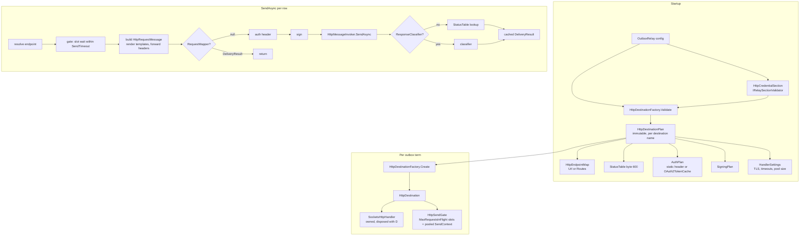
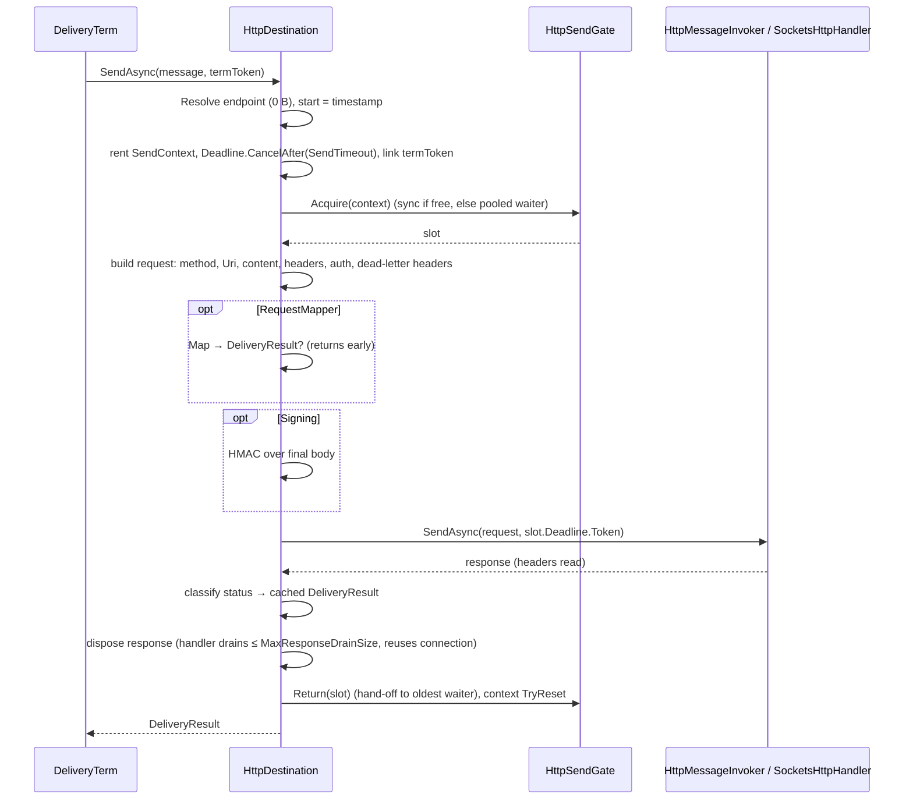

# Design: HTTP destination

**Spec ID:** 2026-11-26-http-destination
**Requirements:** [requirements.md](./requirements.md)

## Overview

New package `Pernix.OutboxRelay.Destination.Http`, transport `Http`. One request per row, body = `OutgoingMessage.Payload` as is. Config compiles at startup into an immutable plan per destination: endpoints, URL/header templates, forwarding rules, status table, auth, signing, TLS. Send path renders only per-row values, sends through an owned `SocketsHttpHandler` via `HttpMessageInvoker`, classifies the status into a `DeliveryResult`. Per-request mutable state lives in pooled objects: deadline CTS + waiter in a `SendContext` per pending send, HMAC + header-string caches + URL buffer in one of `MaxRequestsInFlight` send slots.

Base: `main` `a2345be`. Requirements: Req1-Req20, decisions Q1-Q10 in [requirements.md](./requirements.md).

## Code Reuse Analysis

### Existing Components to Leverage
- **`IDestinationFactory` / `IDestination` / `IRelaySectionValidator`** (`src/Pernix.OutboxRelay.Core/Abstractions/`): implemented as is. No contract change.
- **`RelayOptionsBinder.BindSection<T>`**: strict binding of `Http` block and `HttpCredentials:<name>` (unknown keys refused), same as Kafka.
- **`DestinationOptions.CoreKeys`**: unknown sibling-key check, copied pattern from `KafkaDestinationFactory.Validate`.
- **`KafkaDestinationFactory` structure**: `Validate` resolves and caches a plan by destination name (`ConcurrentDictionary<string, …>`, OrdinalIgnoreCase), `Create` throws if not validated. Http factory follows it.
- **`KafkaAddressMap`**: shape of `HttpEndpointMap` (`Single` / `FrozenDictionary` by route / `Resolve` allocates nothing).
- **`KafkaSendSlotPool<TSlot>`**: lock + `Stack<TSlot>` rent/return pattern. Http slot pool needs no opaque handle/generation, so reuse the pattern, not the type (type is internal to Kafka assembly, generation logic unused).
- **`KafkaDestinationServiceCollectionExtensions` / `KafkaClusterSection`**: registration (`TryAddSingleton`, `TryAddEnumerable`) and bind-once-in-constructor section validator.
- **`KafkaDeadLetterHeaders.Merge`**: same semantics (relay values replace same-name producer headers, failed-at format `yyyy-MM-dd'T'HH:mm:ss.fff'Z'`), reimplemented over strings for Http (Q3: merge logic per transport).
- **Benchmark harness** (`benchmarks/Pernix.OutboxRelay.Benchmarks`): `KafkaOnlyScenario`, `TermScenario`, `TermHost`, `Workload`, `RoundRunner`, `Measurement`, `AllocProfile` (per-type allocation sampling). Http cells mirror Kafka cells.
- **Allocation guard** (`tests/Pernix.OutboxRelay.Unit.Tests/Allocation/`): `AllocationCeilings` rows, `AllocationGuardTests` cell runs.
- **`LogSecrecyTests`**, **`PackageGraphTests`**: extended, not replaced.

### Integration Points
- **Core**: new public `DeadLetterHeaderNames` (Q3) and `RelayOptionsBinder` array-index support (foreman ruling 2026-11-26, `msg_016c54c307f1`): a numeric index is accepted only for `T[]`, `List<T>` and `IReadOnlyList<T>` with scalar `T` (`string`, `int`, `TimeSpan`, enum). An index on a non-collection is still rejected as an unknown setting. Element values are validated by type and never echoed. No other Core change. `KafkaDeadLetterHeaders` constants point at it. Kafka wire output unchanged.
- **Host image**: `Program.cs` `builder.AddOutboxRelay().AddPostgreSqlOutbox().AddKafkaDestination().AddHttpDestination();`, `Pernix.OutboxRelay.Host.csproj` + `Dockerfile` restore lines + `OutboxRelay.slnx`.
- **Config**: `OutboxRelay:Destinations[n]:Http` and `OutboxRelay:HttpCredentials:<name>`.

## Architecture



Rules:
- One `HttpDestinationPlan` per destination name, shared by every instance (probe + one per outbox term). Immutable.
- One `HttpDestination` per `Create`, owns one `SocketsHttpHandler` + `HttpMessageInvoker` + slot pool. Dispose: handler disposed, in-flight sends see `ObjectDisposedException`/cancellation, slots dropped.
- `OAuth2TokenCache` per destination name in the factory, shared across instances (Req9 AC4). It owns its own `SocketsHttpHandler` for the token endpoint (same TLS settings, no auth, no signing).
- No `IHttpClientFactory`, no `HttpClient` (R3 round 0, O2), no logging handler, no `DiagnosticsHandler` (`ActivityHeadersPropagator = null`).

### Modular Design Principles
- One file per concern: options, plan compile, template, forwarding, status table, auth, OAuth2 cache, signer, slot, dead-letter headers, log, registration.
- Plan objects immutable. Mutable per-request state only in `HttpSendSlot`.
- Compile code (startup) separate from render code (send). Compile may allocate freely. Render follows ADR 0005.

## Configuration surface (final names)

Foreman direction: clear descriptive naming, one tense. Working names from requirements → final names:

| Working name (requirements) | Final name | Why |
|---|---|---|
| `Response.Delivered` / `Reject` / `Retry` / `Pause` | `StatusCodes.Delivered` / `Rejected` / `Retried` / `Paused` | Past participle = what happens to the row. One tense. `Retryable` dropped: adjective breaks the tense. `StatusCodes` names the content (codes), `Response` did not. |
| `Timeout` | `SendTimeout` | Covers the whole send, distinct from `ConnectTimeout`. |
| `MaxInFlight` | `MaxRequestsInFlight` | Names the unit. |
| `ForwardHeaders` (All / None / list) | `ForwardHeaders.Mode` (`All` / `None` / `Listed`) + `Names` + `Exclude` + `NamePrefix` | Strict binder needs one type per key. A string-or-list key cannot bind. |
| `ExcludeHeaders`, `ForwardPrefix` | `ForwardHeaders.Exclude`, `ForwardHeaders.NamePrefix` | Grouped under the feature. Prefix applies to the name. |
| `Auth` / `Auth.Mode` | `Authentication` / `Authentication.Scheme` | Full word. `Scheme` is the HTTP term. |
| `Auth.Header`, `Auth.Prefix` | `Authentication.HeaderName`, `Authentication.ValuePrefix` | Unambiguous. |
| `ClientAuth` | `Authentication.ClientCredentialsIn` (`Header` / `Body`) | Says where the client id/secret go. |
| `Signing.Header`, `Signing.Prefix` | `Signing.HeaderName`, `Signing.ValuePrefix` | As auth. |
| `webhook-id` template | `Signing.WebhookId` (default `{outbox}-{id}`) | |
| `Tls.CaCertificate` | `Tls.CaCertificatePath` | Value is a path. |
| `Probe` | `HealthProbe` (`Url`, `Method` default `HEAD`, `Expected` default `["2xx"]`) | Names the purpose. |
| `HttpCredentials.<n>.Key` | split: `ApiKey`, `SigningSecret` | `Key` collided with row `Key` and was ambiguous between auth and signing. |

`HttpVersion` (design-gate amendment, 2026-11-26): string enum, per destination, default `"1.1"`:

| Value | Request `Version` / `VersionPolicy` | URL scheme | Meaning |
|---|---|---|---|
| `"1.1"` | `Version11` / `RequestVersionOrLower` | `http`, `https` | HTTP/1.1 keep-alive. Default. |
| `"2"` | `Version20` / `RequestVersionExact` | `https` only | HTTP/2 negotiated by ALPN. A server without h2 fails the request: `DestinationFault`, no silent downgrade. |
| `"2-cleartext"` | `Version20` / `RequestVersionExact` | `http` only | Prior-knowledge h2c, no upgrade. |

h2c decision: allowed only through the explicit `"2-cleartext"` value, and `"2"` with an `http://` URL is a startup failure. This keeps h2c available for sidecars and meshes (flexibility) without turning a scheme typo into silent cleartext HTTP/2. Applies to every URL of the destination (`Url`, each `Routes` entry, `HealthProbe.Url`). `TokenUrl` always uses `"1.1"`.

Per-route overridable: `Method`, `ContentType`, `Headers`. Values for `Method`, `Scheme`, `Mode`, `Encoding` are case-insensitive enums.

Full keys:

```json
{
  "Name": "LedgerSink",
  "Transport": "Http",
  "Http": {
    "Url": "https://ledger.internal.example/accounts/{key:base64url}/entries?source={outbox}",
    "Method": "PUT",
    "ContentType": "application/vnd.ledger.entry+json",
    "Headers": { "Idempotency-Key": "{outbox}-{id}", "X-Tenant": "{header:tenant-id}" },
    "ForwardHeaders": { "Mode": "Listed", "Names": ["traceparent", "tenant-id"], "NamePrefix": "x-outbox-" },
    "StatusCodes": { "Delivered": ["2xx", "409"], "Rejected": ["400", "422"], "Retried": ["423"] },
    "SendTimeout": "00:00:10",
    "ConnectTimeout": "00:00:03",
    "MaxRequestsInFlight": 16,
    "HttpVersion": "2",
    "Authentication": { "Scheme": "ApiKey", "HeaderName": "X-Api-Key", "Credential": "Ledger" },
    "Signing": { "Scheme": "StandardWebhooks", "Credential": "LedgerSigning" },
    "Tls": {
      "CaCertificatePath": "/etc/relay/tls/internal-ca.pem",
      "ClientCertificate": { "CertificatePath": "/etc/relay/tls/client.crt", "KeyPath": "/etc/relay/tls/client.key" }
    },
    "HealthProbe": { "Url": "https://ledger.internal.example/healthz", "Method": "GET" },
    "RequestMapper": "ledger-envelope",
    "ResponseClassifier": null
  }
}
```

`Routes.<route>` = `{ "Url", "Method"?, "ContentType"?, "Headers"? }`. `Url` xor `Routes`.

`OutboxRelay:HttpCredentials:<name>`: `Username`, `Password`, `Token`, `ClientId`, `ClientSecret`, `ApiKey`, `SigningSecret`, `CertificatePassword`. Needed fields per use:

| Use | Fields |
|---|---|
| `Basic` | `Username`, `Password` |
| `Bearer` | `Token` |
| `ApiKey` | `ApiKey` |
| `OAuth2ClientCredentials` | `ClientId`, `ClientSecret` |
| `Signing` | `SigningSecret` (`StandardWebhooks`: `whsec_` + base64, else raw UTF-8) |
| `Tls.ClientCertificate.Credential` (PFX) | `CertificatePassword` |

## Components and Interfaces

### Core: `DeadLetterHeaderNames`
- **Purpose:** Q3. Dead-letter header name constants shared by transports.
- **Interfaces:** `public static class DeadLetterHeaderNames` in `Pernix.OutboxRelay.Core.Abstractions`: `Reason`, `RetryAttempts`, `OriginalDestination`, `OriginalOutbox`, `OriginalId`, `FailedAt`, `OriginalRoute`, `IReadOnlySet<string> All` (OrdinalIgnoreCase).
- **Reuses:** values from `KafkaDeadLetterHeaders`. Kafka keeps `Merge` and `NameBytes`. Its constants become aliases (`public const string Reason = DeadLetterHeaderNames.Reason;`) or are removed with call sites updated (implementer picks fewer lines). Kafka wire parity tests unchanged.
- **Binder change:** `RelayOptionsBinder` array-index support (foreman ruling 2026-11-26, `msg_016c54c307f1`): a numeric index is accepted only for `T[]`, `List<T>` and `IReadOnlyList<T>` with scalar `T` (`string`, `int`, `TimeSpan`, enum). An index on a non-collection is still rejected as an unknown setting. Element values are validated by type and never echoed.

### `HttpDestinationServiceCollectionExtensions`
- **Interfaces:** `AddHttpDestination(this IServiceCollection, Action<HttpDestinationBuilder>? configure = null)`, same on `TBuilder : IHostApplicationBuilder`. `HttpDestinationBuilder.AddRequestMapper<T>(string name) where T : class, IHttpRequestMapper`, `AddResponseClassifier<T>(string name) where T : class, IHttpResponseClassifier`.
- Registers (`TryAdd*`, repeat-safe): `HttpCredentialSection` (singleton + `IRelaySectionValidator`), `HttpDestinationFactory` (`IDestinationFactory`). Hooks: keyed singletons by name (`AddKeyedSingleton<IHttpRequestMapper, T>(name)`). Repeat registration of the same name: last wins is wrong, so duplicate name with different type throws `InvalidOperationException` at registration.

### `HttpCredentialSection : IRelaySectionValidator`
- Binds `HttpCredentials:<name>` once in constructor (per-element, as `KafkaClusterSection`). `TryGet(name, out HttpCredential)`. Failure paths `HttpCredentials[<name>]: …`, never values.

### `HttpDestinationFactory : IDestinationFactory`
- `Transport => "Http"`.
- `Validate`: unknown sibling keys, `BindSection<HttpDestinationOptions>`, then `HttpPlanCompiler.Compile(options, path, credentials, hooks, failures)`. All config-stage rules of Req2-Req11, Req13 AC1, Req16 AC3. On success caches plan by name.
- `Create`: new `HttpDestination(plan, context, tokenCache, logger)`. Probe instance (`context.IsProbe`) runs `ValidateAsync` only.

### `HttpPlanCompiler` (startup only)
- Produces `HttpDestinationPlan { HttpEndpointMap Endpoints; HeaderForwarding Forwarding; StatusTable Status; AuthPlan Auth; SigningPlan? Signing; HandlerSettings Handler; TimeSpan SendTimeout; int MaxRequestsInFlight; IHttpRequestMapper? Mapper; IHttpResponseClassifier? Classifier; HealthProbePlan? Probe; string Host /* for messages */ }`.
- Validates URLs: `Uri.TryCreate(literalPrefix, Absolute)`, scheme `http`/`https`, no placeholder before path start, no userinfo, no fragment.

### `ValueTemplate`
- **Purpose:** precompiled placeholder template (no templating engine, NG1/NG5).
- **Data:** `Segment[]` where `Segment = { Kind (Literal|Outbox|Destination|Id|Route|Key|KeyHex|KeyBase64Url|Header), string? Literal /* pre-encoded for Url */, string? HeaderName }`. `bool IsConstant` + `string? Constant` when no per-row segment (built once, 0 B per send).
- **Interfaces:** `bool TryRender(in RenderContext row, TemplateTarget target /* Url | HeaderValue */, out string value, out DeliveryResult? fault)`. Two passes: measure length (stackalloc scratch for encoded key/header ≤ 256 B, else `ArrayPool<byte>`), then `string.Create(length, state, write)`. One string per templated value per send. Percent-encoding: RFC 3986 unreserved kept, rest `%XX` uppercase. Header target: CR/LF/NUL → `MessageFault(Permanent: true)`.
- `{outbox}`, `{destination}` and, on a `Routes` entry, `{route}` fold into literals at compile, encoded once (R3 C2). A template with only those is constant. Per-row segments: `{id}` (`long.TryFormat` into the span), `{key}`, `{key:hex}`, `{key:base64url}`, `{header:*}`.
- URL target: a per-row value rendering to exactly `.` or `..` as a whole path segment → permanent `MessageFault` (dot-segment rule, R3 C3). Templated URLs render into the slot `UrlBuffer`, then one string + one `Uri` with `DangerousDisablePathAndQueryCanonicalization` (literal segments checked canonical at compile).

### Per-row render faults (Req4)

All `MessageFault(Permanent: true)`, fixed text naming placeholder or header name, never the value:
- Req4 AC5: `{key}` with null key or invalid UTF-8.
- Req4 AC6: `{key:hex}` / `{key:base64url}` with null key.
- Req4 AC7: `{header:<name>}` with no such row header.
- Dot-segment (R3 C3, K3): a per-row placeholder whose rendered value is exactly `.` or `..` and forms a whole URL path segment. Applies with or without `DangerousDisablePathAndQueryCanonicalization`.

### `HttpEndpointMap` / `HttpEndpoint`
- `HttpEndpoint { HttpMethod Method (static instances); Uri? StaticUri; ValueTemplate? UrlTemplate; HeaderPlan Headers; string ContentType; string? RouteLabel; DeliveryResult[] FaultsByStatus /* lazily filled, index = status code */ }`.
- `StaticUri` shared by every request of the endpoint (Uri is immutable). Templated URL renders string → `new Uri(string, UriKind.Absolute)` per send.
- `Resolve(OutgoingMessage)` same rules as `KafkaAddressMap.Resolve`, 0 B.

### `HeaderPlan` / `HeaderForwarding`
- `HeaderPlan`: ordered `(string Name, ValueTemplate Value)[]` after route merge, name-deduped at compile. Constant values pre-built.
- `HeaderForwarding { Mode; FrozenSet<string> Names; FrozenSet<string> Exclude; string? NamePrefix }`. `Reserved` FrozenSet (OrdinalIgnoreCase): `Connection`, `Keep-Alive`, `Proxy-Connection`, `Transfer-Encoding`, `TE`, `Trailer`, `Upgrade`, `Host`, `Content-Length`, `Expect`, `Authorization`, `Proxy-Authorization`, `Cookie`. Also skipped: names set by `Headers` or relay-owned headers (later source wins, Req5 AC1) and `content-type` (moved to content headers, Req6 AC2).
- Per send: one pass over `message.Headers`, token check on name (`SearchValues<char>` of RFC 9110 tchar), CR/LF/NUL check on value bytes (`IndexOfAny`), case-dup check (n ≤ 8: pairwise `OrdinalIgnoreCase`, else per-slot `HashSet` reused and cleared), value string via slot `HeaderValueCache`, `TryAddWithoutValidation(name, value)`.
- `NamePrefix`: prefixed name per row header name via a bounded per-slot cache (≤ 64 names). Overflow: concat per send.

### `StatusTable`
- `byte[600]` class per code, built once from defaults and `StatusCodes` (Q7: listed class replaces its default set). Defaults: `Delivered` `2xx`, `Rejected` `400`, `413`, `414`, `415`, `422`, `Retried` empty, everything else `Paused` incl. `500` (Q1).
- Result per endpoint and code cached in `HttpEndpoint.FaultsByStatus` (DeliveryResult records are immutable, shareable). Fault text `HTTP 503` or `route 'alerts': HTTP 503`.

### `AuthPlan` / `OAuth2TokenCache`
- `Basic` / `Bearer` / `ApiKey`: `(string Name, string Value)` built once. 0 B per send.
- `OAuth2ClientCredentials`: `OAuth2TokenCache.GetAsync(ct)`: fast path returns cached `(string HeaderValue, DateTimeOffset ExpiresAt)` (`Bearer <token>` built once per fetch), 0 B. Expired: single-flight via `SemaphoreSlim(1)` + double-check. Fetch: `POST TokenUrl` `application/x-www-form-urlencoded` `grant_type=client_credentials` (+ `scope`, `audience`), client credentials in `Authorization: Basic` or body per `ClientCredentialsIn`. Parses `access_token`, `expires_in` with `Utf8JsonReader`. Expiry = now + `expires_in` − 60 s (min 0). `Invalidate(string headerValue)` on `401` clears only if still the same token (no stampede).
- Fetch failure: `DestinationFault("OAuth2 token: HTTP 400")` or exception type. Logged `HttpTokenRefreshFailed` (301) with destination + token host.

### `RequestSigner`
- `HmacSha256`: slot `IncrementalHash.CreateHMAC(SHA256, secret)` reused: `AppendData(payload)`, `TryGetHashAndReset(stackalloc 32)`, encode hex/base64 into `string.Create` with `ValuePrefix`. One string per send.
- `StandardWebhooks`: `webhook-id` = rendered `Signing.WebhookId` (shares the string when the template text equals a `Headers` template, dedup at compile), `webhook-timestamp` = Unix seconds string cached per slot per second, signature input appended piecewise (`id` UTF-8 via stackalloc, `.`, timestamp, `.`, payload). `webhook-signature` = `v1,` + base64. One string (+ id string if not shared).
- Runs after mapper, over `request.Content` bytes: when mapper replaced content, signer reads it via `ReadAsByteArrayAsync` (mapper path allocates, host-owned cost).

### `HttpSendSlot` / `HttpSendGate`
- **Slot fields:** `IncrementalHash? Hmac`, `HeaderValueCache Values` (16 names), `PrefixedNameCache? Names` (32), `char[] UrlBuffer` (256, grows), `string? LastTimestamp`, `long LastTimestampSecond`. Exactly `MaxRequestsInFlight` slots, created lazily.
- **Gate:** see R3 Round 1 `HttpSendGate`. Pooled `SendContext` per pending send owns the deadline CTS and waiter. Slot wait counts against `SendTimeout`. Timeout while waiting → `DestinationFault("timeout waiting for a request slot")`.

### `HttpDestination : IDestination`
- `SendBound => plan.SendTimeout`. `Routes => plan.Endpoints.Routes`.
- `ValidateAsync`: OAuth2 token fetch (if configured), `HealthProbe` request (if configured). Never a request to a main `Url` (Req13 AC2). Failure → `DestinationValidationException` naming destination and host.
- `SendAsync`: see send flow. `[AsyncMethodBuilder(typeof(PoolingAsyncValueTaskMethodBuilder<>))]` (R3 O9).

### `HttpHandlerFactory`
- Builds `SocketsHttpHandler` per `HttpDestination` from `HandlerSettings` (R3 O8 lists every property). `UseProxy = true` only when `HTTPS_PROXY`, `HTTP_PROXY` or `ALL_PROXY` (exact upper- or lower-case name, non-empty) is set at handler build, else `false` (R3 amendments). Request version per `HttpVersion` (R3 C8, amended): `"1.1"` → `Version11` + `RequestVersionOrLower`. `"2"` and `"2-cleartext"` → `Version20` + `RequestVersionExact`. Set on every `HttpRequestMessage` from the plan, 0 B (static `Version` instances).
- h2 handler settings: `EnableMultipleHttp2Connections = true`, so `MaxRequestsInFlight` above the server's `SETTINGS_MAX_CONCURRENT_STREAMS` opens another connection instead of queueing inside the handler. `MaxConnectionsPerServer` is not relied on under h2. `HttpSendGate` bounds concurrent streams in both versions, so connections ≤ ceil(`MaxRequestsInFlight` / server max streams). `KeepAlivePingDelay` default (off), `InitialHttp2StreamWindowSize` default (64 KB), `MaxResponseDrainSize`/`ResponseDrainTimeout` as for 1.1 (an unread h2 body resets or drains the stream, the connection stays).
- TLS: `SslOptions.RemoteCertificateValidationCallback` only when `CaCertificatePath` set: chain built with `X509ChainTrustMode.CustomRootTrust` + loaded PEM bundle (loaded once at plan compile). Client certificate: `X509Certificate2.CreateFromPemFile` / PFX loaded at compile, set via `SslOptions.ClientCertificates`. No setting disables validation (Q5).

### `HttpDeadLetterHeaders`
- Adds dead-letter headers as strings directly onto `request.Headers` (no `MessageHeaders` round-trip): `Reason` (existing string), `RetryAttempts` (cached strings 0-100, else format), `OriginalDestination`/`OriginalOutbox` (cached per configured name, bounded like `NameBytes`), `OriginalId` (format), `FailedAt` (format), `OriginalRoute` (existing string). Forwarding skips producer headers with `DeadLetterHeaderNames.All` names on dead-letter sends.

### Hooks (Req16, Q10)
```csharp
public interface IHttpRequestMapper
{
    // Mutates request (URL, headers, content). Null: send. Non-null: return it, nothing sent.
    DeliveryResult? Map(OutgoingMessage message, HttpRequestMessage request);
}

public interface IHttpResponseClassifier
{
    DeliveryResult Classify(HttpResponseMessage response, ReadOnlySpan<byte> bodyPrefix);
}
```
- Classifier gets up to 4 KB body prefix, read into a pooled `ArrayPool<byte>` buffer only when a classifier is configured.
- Hook throws → `DestinationFault("<ExceptionType> in request mapper '<name>'")`. Never the message.
- Image registers none.

### `HttpLog` (event ids 300-309)
- 300 `HttpClientCreated` (Debug): destination, host, max connections.
- 301 `HttpTokenRefreshFailed` (Warning): destination, token host, status code or exception type.
- 302 `HttpProbeFailed` (Warning): destination, host, method, status code or exception type.
- Never: path, query, header values, body, response body, credentials.

## Send flow



Exception mapping in `SendAsync` (never throws for delivery failures, Req8 AC2):

| Caught | Result |
|---|---|
| `OperationCanceledException` and `termToken.IsCancellationRequested` | rethrow (shutdown) |
| `OperationCanceledException` (deadline) | `DestinationFault("timeout after <SendTimeout>")` |
| `HttpRequestException` | `DestinationFault("HttpRequestException: <HttpRequestError>")` (`ConnectionError`, `NameResolutionError`, `SecureConnectionError`, …) |
| `IOException`, `SocketException`, `AuthenticationException` | `DestinationFault("<Type>")` |
| `ObjectDisposedException` (send racing destination dispose at term end) | `termToken.IsCancellationRequested`: rethrow as `OperationCanceledException(termToken)`. Else `DestinationFault("ObjectDisposedException")`. Never thrown raw (Req8 AC2). |
| hook exception | `DestinationFault` per hooks |
| contract violation (unresolvable endpoint) | `ArgumentException` (same as Kafka, Core bug) |

## R3: allocation per request

Ruling: "Challenge R3 during the design. Have spec C back and forth with architect to find pooled object strategies and minimize allocations under load." ADR 0005: hot path avoids avoidable allocations, reuses objects and buffers, prefers shared immutable instances, never trades correctness or clarity for a micro-gain, measures when a gain is unclear.

Proposal R3 claim: 1-2 KB/msg vs Kafka 191.5-248.3 B/msg (`term`), not measured.

### Round 0: inventory (architect draft, sent to coordinator)

Reference cell: `term <mode> http b500 h1`: static URL, HTTP/1.1 keep-alive, 1 forwarded header (16-char value), no auth, no signing, `204` response with 2 server headers. 64-bit sizes, estimates from .NET 10 type layouts, to be replaced by `AllocProfile` measurement (Round plan below).

Naive path = `HttpClient` + `using var cts = CreateLinkedTokenSource(ct); cts.CancelAfter(t)` + `new HttpRequestMessage(method, url)` + `new ReadOnlyMemoryContent(payload)` + typed `ContentType` + `await client.SendAsync(req, ResponseHeadersRead, cts.Token)` + read status + dispose.

| # | Object (per request) | Naive B (est) | Option | Safety constraint | Decision R0 | Target B |
|---|---|---|---|---|---|---|
| O1 | `Uri` + URL string | 250-400 | Static URL: one shared `Uri` per endpoint. Templated: unavoidable string + `Uri`. | `Uri` immutable, thread-safe. | Adopt. | 0 static, ~300 templated |
| O2 | `HttpClient.SendAsync` layer: linked CTS (`_pendingRequestsCts` + caller), its state machine box, timeout handling | 300-450 | Use `HttpMessageInvoker(handler, disposeHandler: true)`: calls the handler directly. Own timeout in O6. Response body not buffered (handler returns at headers, like `ResponseHeadersRead`). | `HttpMessageInvoker` is the public base of `HttpClient`, thread-safe for concurrent sends. Loses `HttpClient.Timeout` and `MaxResponseContentBufferSize` (both unused). | Adopt. ADR 0005: removes a layer, no clarity cost. | 0 |
| O3 | `HttpRequestMessage` | ~80 | Reuse per slot. | `HttpClient` forbids resend (`MarkAsSent`). Invoker path does not check, but reuse is undocumented: `HttpResponseMessage.RequestMessage` aliases it, handler may mutate it (auth/redirect paths off, still not contracted), E1 mapper may keep a reference. | Reject. ADR 0005: correctness over micro-gain (~80 B). | ~80 |
| O4 | `HttpRequestHeaders` + `HeaderEntry[]` (grows 4 → 8 …) | 150-250 | (a) `TryAddWithoutValidation(name, string)` only: raw string stored, no parsed `HeaderStoreItemInfo`, written as is. (b) Pre-sizing: no public API. | Raw values skip validation: Http does its own token and CR/LF/NUL checks first (Req5 AC6, AC9). | Adopt (a). | 150-250 (count-driven) |
| O5 | Forwarded header value strings (UTF-8 decode) | 22 + 2n each | Slot `HeaderValueCache`: per name, last `(byte[] ref, string)`. Hit when same array reference (dead-letter resend, retries of the row) or `SequenceEqual` bytes (constant headers: `ce-specversion`, `content-type`, `tenant-id`). Miss decodes. | Per slot, no sharing, no lock. Bounded (16 names, overflow decodes). Strings immutable. Byte compare cost ≤ value length. | Adopt. Unique-per-row values (`traceparent`, ids) still decode: HttpHeaders take strings only. | 0 hit, 22 + 2n miss |
| O6 | Deadline: linked CTS + `CancelAfter` timer + caller registration | 200-300 | Slot-owned CTS: `CancelAfter(remaining)` (reuses the CTS's timer after first use), `termToken.UnsafeRegister(static s => ((CTS)s).Cancel(), cts)` (term CTS reuses freed callback nodes), unregister + `TryReset()` on return. Replace CTS when `TryReset` fails. | `TryReset` false after cancel: replaced, never reused cancelled. One slot = one request at a time. | Adopt. | 0 steady |
| O7 | Content: `ReadOnlyMemoryContent` + `HttpContentHeaders` + entries + typed `MediaTypeHeaderValue` (+ its `ToString` on write) + `Content-Length` box | 250-400 | (a) `new ReadOnlyMemoryContent(payload)` per send, `Content-Type` via `TryAddWithoutValidation` cached string, `Content-Length` computed by `TryComputeLength`. (b) Reuse one `PayloadContent : HttpContent` per slot with `Reset(ReadOnlyMemory<byte>)`. | (b): request dispose disposes content, so slot must own content and not dispose request. `HttpContentHeaders.ContentLength` getter may store the computed length: a reused content could send a stale `Content-Length` (Req6 AC5). SocketsHttpHandler does re-serialize the same content on its internal connection retry, so re-serialization is supported, length caching is the open hazard. | (a) now. (b) measure-gated: adopt only if measurement shows ≥ 100 B/msg saved and a test proves per-send `Content-Length` = payload length across reuse. | 150-250 (a) |
| O8 | `SocketsHttpHandler` internals: pool/connection async boxes, `HttpResponseMessage`, `HttpResponseHeaders` + entries, server header value strings, response content + stream | 900-1,400 | Not replaceable without a custom HTTP client (rejected: TLS, HTTP/1.1 framing, connection pool are correctness surface). Reduce via settings: `AllowAutoRedirect = false`, `UseCookies = false`, `AutomaticDecompression = None`, `UseProxy = true` only when `HTTPS_PROXY`, `HTTP_PROXY` or `ALL_PROXY` (exact upper- or lower-case name, non-empty) is set at handler build, else `false` (amendment: task 1 spike measured the default system-proxy lookup at ~539 B/req on macOS, 1,848 vs 1,320 B/req; coordinator decision 2026-11-26, within Req11 AC5 / NG7), `ActivityHeadersPropagator = null` (no `DiagnosticsHandler`), `PreAuthenticate = false`, `Credentials = null`, `MaxConnectionsPerServer = MaxRequestsInFlight`, `PooledConnectionLifetime = 5 min` (DNS), `PooledConnectionIdleTimeout = 90 s`, `ConnectTimeout`, `MaxResponseDrainSize = 64 KB`, `ResponseDrainTimeout = 2 s`, `MaxResponseHeadersLength` default. Request `Version = 1.1`, `VersionPolicy = RequestVersionOrLower`. Response body: dispose response, handler drains and reuses connection (no own drain buffer unless classifier). | Settings are per handler, set before first send, immutable after. Server-chosen header count drives response cost (outside relay control). | Adopt settings. Accept residual. | 900-1,400 |
| O9 | Own `SendAsync` state machine box | 150-250 | `[AsyncMethodBuilder(typeof(PoolingAsyncValueTaskMethodBuilder<>))]` on `SendAsync`. | Pooled boxes require await-once of the `ValueTask` (Core awaits once: `DeliveryTerm` `Send` / dead-letter path). | Adopt. | 0 steady |
| O10 | Slot wait (`MaxRequestsInFlight`) | 0 uncontended, ~100-200 contended | `SemaphoreSlim.WaitAsync(timeout, ct)`: synchronous completion returns a cached task. Contended waiter allocates a node. | Under `None` with 5,000 queued sends and saturated endpoint, waits allocate; acceptable, wait time dominates. | Adopt. | 0 (cell is uncontended at 64) |
| O11 | Static headers (constant `Headers`, auth `Basic`/`Bearer`/`ApiKey`, OAuth2 `Bearer` value) | 0-200 if rebuilt | Built once at compile / per token fetch. | Strings immutable. | Adopt. | 0 |
| O12 | Templated header values (`{outbox}-{id}`) | 40-80 each | `ValueTemplate` single `string.Create` per value. Same template text rendered once per send and shared (`Idempotency-Key`, `ce-id`, `webhook-id`). | Shared string across headers of one request: immutable. | Adopt. | 1 string per distinct template |
| O13 | HMAC (`HmacSha256`, `StandardWebhooks`) | 400+ (`HMACSHA256` per send + `byte[]` hash + concat input) | Slot `IncrementalHash` reused, hash to `stackalloc`, input appended piecewise, signature `string.Create`. Timestamp string cached per slot per second. | `IncrementalHash` not thread-safe: per slot. Secret bytes held per slot (same secrecy as plan). | Adopt. | 1 string (~100 B) |
| O14 | `DeliveryResult` per outcome | 0-40 | `Delivered.Instance`, fault results cached per endpoint × status code. | Records immutable. | Adopt. | 0 |
| O15 | Dead-letter headers | `Merge` → `MessageHeaders` + `byte[]` per value + decode back to strings | Strings directly (component `HttpDeadLetterHeaders`), cached names, cached small ints. | Same replacement semantics as Kafka (`Merge`). | Adopt. | 2 strings (`OriginalId`, `FailedAt`) |

Round 0 totals (reference cell, Http destination only, excl. Core `term` loop ~192-213 B/msg):

| | Naive | Target |
|---|---|---|
| Relay-controlled (O1, O2, O5, O6, O9, O11-O14) | 900-1,500 | ~0-60 |
| Framework floor (O3, O4, O7, O8) | 1,450-2,150 | 1,280-1,980 |
| Total | 2,350-3,650 | ~1,300-2,000 |

R0 position on R3: the 1-2 KB estimate is a floor set by `HttpRequestMessage` + headers + `SocketsHttpHandler`, not by relay code. Relay-controlled allocations go to ~0. The remaining lever is O7(b) (measure-gated). Below ~1 KB needs a custom HTTP client, rejected.

### Round 1: coordinator challenge (msg `msg_a2fb5fa5e297`)

Coordinator accepted: O2, O3 reject, O4(a), O6, O9, O11, O13, O14, O15, no-custom-client rejection, measurement plan structure. Challenges C1-C9, answered:

| Code | Challenge | Decision | Why |
|---|---|---|---|
| C1(a) | Contention is the load case. `SemaphoreSlim` contended `WaitAsync(timeout, ct)`: `TaskNode` (~100 B) + timeout path async box (~150-200 B) + its timer/linked CTS (~150-200 B) ≈ 400-500 B per waiting send. | Replace O10 with `HttpSendGate` (below): pooled `SendContext` per pending send owns the deadline CTS and a `ManualResetValueTaskSourceCore<HttpSendSlot>` waiter. Contended wait 0 B steady. | Under `None`, b500 vs 64 slots, ~87% of sends wait. ADR 0005: the load regime is the hot path. |
| C1(b) | Zero-alloc acquire/return. | Slots: fixed `HttpSendSlot[MaxRequestsInFlight]` + `int[]` free-index stack + `top`. Waiters: `SendContext[]` FIFO ring (grows by doubling to peak pending, then fixed). All under one `System.Threading.Lock`, O(1) critical sections. Return hands the slot straight to the oldest waiter (`SetResult` outside the lock), no wake-and-retry. No `Concurrent*` collections. Lock-free index stack evaluated: needs ABA-tagged 64-bit head, 0 B either way, more code. Rejected for clarity (ADR 0005), lock hold time is ns vs ms network. | 0 B after warm-up, FIFO fairness, no thundering herd. |
| C1(c) | Saturated cell. | Harness + guard cell `term None http-sat b500 h1` (`MaxRequestsInFlight` 8). | Exercises gate wait/hand-off every send. |
| C2 | Fold startup constants. | `{outbox}`, `{destination}`, `{route}` (per `Routes` entry) fold into literals at compile, encoded once. URL/value is per-send only with `{id}`, `{key}`, `{key:hex}`, `{key:base64url}`, `{header:*}`. Otherwise `StaticUri` / constant string. O1 target static: 0 B. O12 target: 0 B for folded templates, one string per distinct per-row template. | Startup-known values never cost per send. |
| C3 | Templated URL common case. | Render into slot-owned `char[]` (grown to max seen, startup size 256), then one `new string(span)` and one `new Uri(string, in UriCreationOptions { DangerousDisablePathAndQueryCanonicalization = true })`. No intermediate concat. Harness + guard cell `term None http-tpl b500 h1` (`/orders/{id}?key={key}`). | One string + one `Uri` per send is the floor for a per-row URL (`HttpRequestMessage` needs an absolute `Uri`). |
| C3 safety | Is disabling canonicalization safe? | Yes, with three compile/render rules: (1) compile checks each literal path/query segment is already canonical (`Uri` of the literal-only URL round-trips unchanged), else config failure. (2) placeholders always percent-encode outside RFC 3986 unreserved, so values cannot add `/`, `?`, `#`, `%`. (3) new rule found here: unreserved includes `.`, so a value rendering to exactly `.` or `..` as a whole path segment would be a dot-segment (path traversal on servers that normalize). Render returns permanent `MessageFault("placeholder '{key}' renders a dot segment")`. Rule 3 applies with or without the flag (canonicalization would otherwise remove the segment itself). Scheme/host/port stay literal (SSRF guard unchanged). | Flag skips the path/query canonicalization pass only, host parse still runs. Gain is CPU, bytes measured in the spike. Kept only if the dot-segment tests pass. |
| C4 | Forwarded names. | Name forwarded by reference (0 B). `HeadersParser` caches up to 32 names per session, so names are the same instance across rows and caches hit on reference equality first, then ordinal. `NamePrefix`: `Mode Listed` precomputes prefixed names at compile (bound = list size, 0 B). `Mode All`: per-slot prefixed-name cache, 32 entries (matches `HeadersParser.NameCacheSize`), overflow concat per send. | 0 B for every realistic header set. |
| C4 O5 | Value cache cost. | Lookup: reference-equal `byte[]` → hit. Else length check, then `SequenceEqual`. Always-unique `traceparent` (55 B): one length-equal vectorized compare, two 32-byte vector ops, ~2-5 ns, then decode (~20 ns + 132 B string) and overwrite the entry. Compare cost ≤ 5% of the decode it tries to avoid. Accepted. | Constant headers 0 B, unique headers pay a negligible compare. |
| C5 | O7(b) hazard real. | O7(b) rejected. (1) `HttpContentHeaders.ContentLength` getter stores the computed length: reuse needs remove + set per send, setting boxes a `long` (24 B) + parsed store item (~40 B), net gain ~60-100 B, below the ≥100 B gate. (2) Early-response hazard: a server may answer (e.g. `413`) before the request body is fully written; the handler may still be serializing the content when the response returns. Resetting a reused content for the next send while the old serialization runs could send wrong bytes on the old connection. (3) `HttpRequestMessage.Dispose` disposes its content (nothing unmanaged in the request itself, no finalizer), so (b) would also require never disposing requests. Correctness hazard + gain under gate. | ADR 0005: never trade correctness for a micro-gain. O7(a) stays: new `ReadOnlyMemoryContent` per send, request disposed after response disposal. |
| C6 | Response realism. | Reference response: `HTTP/1.1 200 OK` + `Date`, `Content-Type: application/json`, `Content-Length: 100`, `Server`, `X-Request-Id` (unique per response), `Cache-Control: no-store` + 100 B JSON body, unread. `204` + 2 headers kept as harness option `--response 204`. Drain: response dispose disposes `HttpConnectionResponseContent` and its `ContentLengthReadStream`; a body already in the connection read buffer drains synchronously (0 B) and the connection returns to the pool. A body not yet received drains asynchronously (async box ~100-200 B) up to `MaxResponseDrainSize` 64 KB / `ResponseDrainTimeout` 2 s, then the connection returns; over cap or timeout the connection closes. Must keep the connection: harness asserts no connection growth after warm-up and connects ≤ window / `MaxRequestsInFlight` (no reconnect per send; amended, the pool opens connections for queued requests that other connections serve, measured in task 1, `BASELINE.md`), integration test asserts the same against Kestrel. Expected response header cost: `X-Request-Id` and `Content-Length` strings per send (~100 B), `Date`/`Server` cached per connection by the handler when unchanged, `Content-Type`/`Cache-Control` matched to known values (0 B if matched). Spike measures. | Guard measures the realistic floor, not a best case. |
| C7 | Budget form. | Split budget below: relay-owned target vs framework floor. Relay-owned isolated by a stub-handler cell (`http-stub`). Spike fills the table from `AllocProfile` per-type output (`--profile`). Measured table written to `benchmarks/Pernix.OutboxRelay.Benchmarks/BASELINE.md` section `## Http destination` and summary in `BENCHMARKS.md`, since design.md freezes at approval. | Regression in relay code shows in `http-stub` and relay-owned types. Framework change shows only in loopback cells. |
| C8 | HTTP version. | Amended at the design gate (foreman, 2026-11-26): declarative `HttpVersion` setting `"1.1"` (default) \| `"2"` (TLS, `RequestVersionExact`) \| `"2-cleartext"` (prior-knowledge h2c). Default stays 1.1. h2 measured by the `term None http2` guard cell. | Original "HTTP/1.1 only" was an imposed contract choice against the flexible/unopinionated principle. 1.1 stays the default because it is the most compatible, and h2 costs are now measured, not assumed. |
| C9 | Cell inventory. | Below. Guard +9 cells (incl. `http2`, amendment), existing 24 ceilings unchanged. | Small CI time. |

#### `HttpSendGate` (replaces O10)

- `SendContext` (pooled, one per pending send): `CancellationTokenSource Deadline`, `CancellationTokenRegistration CallerLink`, `CancellationTokenRegistration WaitLink`, `ManualResetValueTaskSourceCore<HttpSendSlot> Waiter`, `int State` (Idle / Waiting / Granted / Cancelled, changed only under the gate lock), `int Generation`. Pool: `Stack<SendContext>` under the gate lock. Retention policy: grows to peak pending sends, never trimmed, freed with the destination instance (term end). Bound: Core's in-flight sends per term (`None`: 10 × `BatchSize` = 5,000 at default), ~300 B each ≈ 1.5 MB worst case. `flat`/`churn` heap checks cover it.
- Return on every exit path: `SendAsync` body is `try { … } finally { gate.Release(slot?); contexts.Return(context); }`. Covers success, every mapped fault, early mapper short-circuit, mapper/classifier throw, template/forwarding fault, shutdown cancellation, and `ObjectDisposedException` after dispose. A context whose waiter completed is returned only after its `ValueTask` was awaited (pooled `ValueTask` source: await-once).
- `SendAsync`: rent context → `Deadline.CancelAfter(SendTimeout)` + `CallerLink = term.UnsafeRegister(cancel deadline)` → `Acquire(context)`: free slot → synchronous, else enqueue and await `new ValueTask<HttpSendSlot>(context, version)`.
- Enqueue (under the lock): `Generation++`, `State = Waiting`, write ring entry `WaiterEntry(context, Generation)` (`readonly struct`, ring is `WaiterEntry[]`), then `WaitLink = Deadline.Token.UnsafeRegister(onWaitCancelled, context)`.
- Cancellation while waiting (deadline or term token, both fire `Deadline`): the `WaitLink` callback takes the gate lock and, if `State == Waiting`, sets `State = Cancelled` and completes the waiter with `OperationCanceledException`. The ring entry stays as a tombstone, so no O(n) removal.
- Tombstone reuse guard (D1): a cancelled context can be returned, re-rented and re-enqueued before hand-off reaches its old entry. The old entry then names a context that reads `Waiting` again. Each entry carries the generation written at enqueue, and hand-off treats an entry as live only if `entry.Generation == entry.Context.Generation && entry.Context.State == Waiting`. The stale entry fails the generation check and is skipped. So one context has at most one live entry, each grant goes to exactly one live waiter, and no `SetResult` hits a reset or reused `ManualResetValueTaskSourceCore` version. 0 B: the entry is a struct in the preallocated ring, the generation is an `int` field, and the check is two compares under the lock. Considered instead: storing the ring index in the context and nulling the entry on cancel. Rejected because ring growth would have to rewrite every waiting context's index. The generation check is position-independent.
- Hand-off (`Return(slot)`): under the lock, dequeue from the ring head, clearing each dequeued entry (`default`, so the ring holds no stale reference) and skipping entries that are not live (tombstone or stale generation), until a live entry is found; set it `Granted` and assign the slot under the lock, then `SetResult` outside the lock. No waiter → push slot index to the free stack.
- Cancel-vs-hand-off race: both transitions run under the gate lock and check `State == Waiting` first, so exactly one wins. Cancel wins: hand-off skips the tombstone and the slot goes to the next waiter or the free stack. Hand-off wins: the cancel callback sees `Granted` and does nothing; the send proceeds, sees `Deadline` cancelled at the next await, maps to `DestinationFault` (or rethrows on shutdown), and returns the slot in `finally`. No path leaks a slot.
- Invariant: `free + held == MaxRequestsInFlight` at every lock release. Debug assert + unit test.
- Same `Deadline.Token` goes to `invoker.SendAsync`. One CTS covers slot wait + token fetch + request (Req8 AC4).
- Context return (D2, D4), in this order:
  1. Outside the gate lock: dispose `WaitLink` (the cancel-while-waiting callback) and `CallerLink`. A reused CTS can then never fire a stale callback against the next send's state. `CancellationTokenRegistration.Dispose` blocks until a running callback finishes, and `onWaitCancelled` takes the gate lock. Disposing while holding the lock would deadlock against a concurrently firing callback, so it never happens under the lock.
  2. Outside the lock: `Deadline.TryReset()` (dispose and replace the CTS if it returns false), then `Waiter.Reset()` (bumps the source version).
  3. Under the gate lock: `State = Idle`, push to the pool. Nothing else.
  After step 1 no callback of this send is running or can start.
- Lock discipline (D4): no code calls `CancellationTokenSource.Cancel` or completes a waiter while holding the gate lock, so `onWaitCancelled` and waiter continuations never run inline under it. `onWaitCancelled` writes `State = Cancelled` under the lock, then calls `Waiter.SetException` after releasing it. Hand-off does the same with `SetResult`. `Waiter.RunContinuationsAsynchronously = true`, so continuations never run on the completing thread. Hand-off never returns a context: the ring only references it, and the owning `SendAsync` returns it exactly once.

#### Round 1 close (coordinator `msg_973fd9b48429`: "R3 agreed", three conditions)

| Condition | Recorded |
|---|---|
| K1 Gate cancellation without slot leak | Mechanism and race above. Tests: timeout-while-waiting, term-cancel-while-waiting, cancel-vs-hand-off race (forced interleaving), cancelled waiter's context re-rented and re-enqueued before hand-off passes its tombstone (each grant goes to exactly one live waiter, slot invariant holds), stale `WaitLink` callback cannot fire after context return (reused CTS cancelled on the next send does not touch the returned context), cancel firing concurrently with context return does not deadlock (forced interleaving, bounded wait such as 5 s), slot-count invariant after N mixed outcomes (success, fault, timeout, cancel, mapper throw). |
| K2 `SendContext` retention + return on every path | Policy and `finally` above. Test: contexts rented == returned after N mixed outcomes incl. mapper/classifier throws. |
| K3 Dot-segment rule | Req4 rules below, error scenario 6, unit tests. |
| Ordering | Spike task first. Its `AllocProfile` per-object table lands in `BASELINE.md` `## Http destination` before any Http guard ceiling is set. |
- This moves O6's CTS from slot to context. Slot keeps `IncrementalHash`, value cache, prefixed-name cache, URL `char[]`, timestamp cache.

### Budget (Round 1)

Per request, `None`, b500, h1, Http destination only (excl. Core `term` loop ~192-213 B/msg). Relay-owned = allocated by `Pernix.OutboxRelay.Destination.Http` code itself (strings it renders, its own objects). Framework floor = objects .NET creates for a request we must build (`HttpRequestMessage`, headers, content, `Uri`) + handler internals + response. Estimates until the spike; the spike's `AllocProfile` per-type table replaces them in `BASELINE.md`.

| Object | Owner | Static ref (est B) | Target / intent |
|---|---|---|---|
| O1 `Uri` (static, folded) | relay | 0 | 0 |
| O2 `HttpClient` layer | relay choice | 0 | 0 |
| O5 forwarded value strings | relay | 0 constant / 22 + 2n unique | per unique header only |
| O6 + C1 deadline + gate | relay | 0 | 0, saturated too |
| O9 state machine | relay | 0 | 0 |
| O11/O12 header values | relay | 0 folded / 1 string per per-row template | per per-row template only |
| O13 signing | relay | 0 (off in ref) / ~100 on | 1 string when on |
| O14 results | relay | 0 | 0 |
| O15 dead-letter headers | relay | n/a / ~100 dlq | 2 strings per dlq-msg |
| **Relay-owned target** | | | **≤ 64 B/msg static ref and saturated (h1 header value is constant in workload), ≤ 64 B + rendered URL string templated, ≤ 192 B/dlq-msg** |
| O3 `HttpRequestMessage` | framework | ~80 | recorded |
| O4 request headers + entries | framework | 150-250 | recorded |
| O7(a) content + content headers | framework | 150-250 | recorded |
| C3 templated `Uri` internals | framework | ~150-250 (tpl only) | recorded |
| O8 handler + response (C6 ref response) | framework | 1,000-1,600 | recorded |
| **Framework floor** | | **1,380-2,180** | **measured, recorded, not targeted** |
| **Total static ref** | | **~1.4-2.2 KB** | guard ceiling = measured median + margin |
| Total templated | | ~1.7-2.6 KB | guard ceiling from measurement |
| Total saturated | | = static ref | guard ceiling from measurement |

Round 1 position on R3: unchanged in shape. Relay-owned bytes ≤ 64 B/msg in every reference cell incl. saturated. The 1.4-2.2 KB total is framework floor, now with a realistic response. Below that needs a custom client (rejected).

### Measurement plan and cells

- Spike task first (before full implementation): minimal send path (static URL, O2, C1 gate, O9) against `HttpLoopback`, `--profile` per-type breakdown. Fills the budget table in `BASELINE.md` `## Http destination`. Measures the C3 flag gain.
- `HttpLoopback` infrastructure: `SocketsHttpHandler.ConnectCallback` returns an in-memory duplex `Stream` that consumes the request (headers to `\r\n\r\n`, then `Content-Length` bytes) and writes a preformatted response (C6 reference, `X-Request-Id` written from a preallocated counter buffer). Allocation-free after warm-up. Same process, so `GC.GetTotalAllocatedBytes` covers the full client stack except socket I/O. Counts connects (C6 assertion).
- `HttpStub`: `HttpMessageHandler` returning a preallocated `HttpResponseMessage` (dispose idempotent, empty content). Isolates relay-owned + request-object bytes.

Harness cells (not guard unless marked G):

| Cell | Purpose |
|---|---|
| `loopback` | Self-check: fake stream alone ≤ 8 B/req, else harness fails. |
| `http <mode> w500 h0/h1/h4` | Destination-only, loopback, C6 response. Breakdown by header count. |
| `http --response 204` | Lower-bound response variant. |
| `http-stub None w500 h1` **G** | Relay-owned + request objects, no handler. Regression in relay code. |
| `http-dlq <mode> w500 h1` | Destination-only dead-letter sends. |
| `term None\|PerKey\|Strict http b500 h1` **G×3** | Main reference cell per mode. |
| `term None http-tpl b500 h1` **G** | Templated URL (C3). |
| `term None http-sat b500 h1` **G** | `MaxRequestsInFlight` 8, contended gate (C1). |
| `term None http2 b500 h1` **G** | `HttpVersion` `"2-cleartext"` against the h2 loopback. Http2Stream, HPACK and framing floor. |
| `term None http-dlq b500 h1` **G** | `PermanentFaultDestination` main, Http dead letter. dlq path is mode-independent. |
| `idle None http interval 1s` **G** | Handler pool timers at idle. One mode, 120 s. |
| real-socket evidence run | Child-process loopback socket server, once, `BASELINE.md`. Shows in-memory stream hides nothing material. |

- Harness changes: `--dests` gains `http`, `http-tpl`, `http-sat`, `http-dlq`, `http2`. `TermHost.Create` takes a dead-letter factory instead of hard-wiring Kafka. Targets `http`, `http-dlq`, `http-stub`, `loopback`.
- h2 loopback (amendment): `HttpLoopback` gains a prior-knowledge h2c mode (`ConnectCallback` stream, so h2c avoids TLS in both the h1 and h2 cells and the comparison stays like for like). The fake reads the 24 B client preface and 9 B frame headers, answers SETTINGS (+ ACK) once, acks the client's SETTINGS, sends connection and stream `WINDOW_UPDATE`s after DATA it consumes so the client never blocks on flow control, ignores PRIORITY/PING/WINDOW_UPDATE from the client, and per stream writes one preformatted `HEADERS` frame plus one `DATA` frame with `END_STREAM`. The HEADERS frame carries a preformatted HPACK block: `:status 200` static index `0x88`, then the C6 headers as literals without indexing, with the `X-Request-Id` value bytes overwritten in place. That is ~200-300 lines with fixed buffers and no HPACK encoder or dynamic table, cheap enough for a guard cell. If the spike shows the fake allocates (self-cell > 8 B/req) or needs more than a minimal framer, the cell falls back to harness-only and the reason is recorded in `BASELINE.md`.
- h2 targets: relay-owned ≤ 64 B/msg, same as 1.1 (relay code does not depend on version). The framework floor (Http2Stream, HPACK decode strings, frame buffers) is measured and recorded, not targeted.
- Guard: 9 new `AllocationCeilings` rows (8 + `term None http2 b500 h1`). `AllocationGuardTests` runs gain the dests above (Term/1 `None,PerKey` + `http`, Term/3 `Strict` + `http`, a new `Http/1` run for `None` `http-tpl,http-sat,http-dlq,http2` and `http-stub`, Idle `None` `http`). Ceilings = median + margin of 5 guard runs on the implementation commit, existing margin rules (`TenPercentReason`, `ThreeSpread`, `IdleNoise`). Never from the estimate. Existing 24 ceilings unchanged (Req18 AC4).
- Records: `BENCHMARKS.md`, `BASELINE.md` with machine + commit.

### Implementation amendments (2026-11-26)
1. `UseProxy` (O8, `HttpHandlerFactory`): on only when `HTTPS_PROXY`, `HTTP_PROXY` or `ALL_PROXY` (exact upper- or lower-case name, non-empty) is set at handler build. Source: task 1 spike, default system-proxy lookup ~539 B/req on macOS (1,848 vs 1,320 B/req). Coordinator decision 2026-11-26, within Req11 AC5 / NG7.
2. C6 connect assertion: no connection growth after warm-up and connects ≤ window / `MaxRequestsInFlight`, not equality with peak concurrency. Source: task 1 measurement, `benchmarks/Pernix.OutboxRelay.Benchmarks/BASELINE.md`.
3. Core `RelayOptionsBinder` array-index support for scalar `T[]` / `List<T>` / `IReadOnlyList<T>` (see Integration Points). Source: foreman ruling 2026-11-26, `msg_016c54c307f1`.

## Data Models

```
HttpDestinationOptions            // bound strictly from Destinations[n].Http
- Url: string?                    // xor Routes
- Routes: Dictionary<string, HttpRouteOptions>?
- Method: string?                 // POST default; POST | PUT | PATCH
- ContentType: string?            // default application/octet-stream
- Headers: Dictionary<string, string>?
- ForwardHeaders: ForwardHeadersOptions?   // Mode All default
- StatusCodes: StatusCodesOptions?         // Delivered, Rejected, Retried, Paused: string[]?
- SendTimeout: TimeSpan?          // 00:00:30
- ConnectTimeout: TimeSpan?       // 00:00:10, ≤ SendTimeout
- MaxRequestsInFlight: int?       // 64, ≥ 1
- HttpVersion: string?            // "1.1" default | "2" | "2-cleartext"
- Authentication: AuthenticationOptions?
- Signing: SigningOptions?
- Tls: TlsOptions?
- HealthProbe: HealthProbeOptions?
- RequestMapper: string?
- ResponseClassifier: string?

HttpRouteOptions { Url: string; Method?; ContentType?; Headers? }
ForwardHeadersOptions { Mode: All|None|Listed; Names: string[]?; Exclude: string[]?; NamePrefix: string? }
AuthenticationOptions { Scheme: None|Basic|Bearer|ApiKey|OAuth2ClientCredentials; Credential?; HeaderName?; ValuePrefix?; TokenUrl?; Scope?; Audience?; ClientCredentialsIn: Header|Body }
SigningOptions { Scheme: StandardWebhooks|HmacSha256; Credential; HeaderName?; Encoding: Hex|Base64; ValuePrefix?; WebhookId? }
TlsOptions { CaCertificatePath?; ClientCertificate: { CertificatePath?; KeyPath?; PfxPath?; Credential? } }
HealthProbeOptions { Url; Method: HEAD default | GET; Expected: string[] default ["2xx"] }
HttpCredential { Username?; Password?; Token?; ClientId?; ClientSecret?; ApiKey?; SigningSecret?; CertificatePassword? }
```

Config-stage rules (Req13 AC1), each failure `OutboxRelay.Destinations[<name>].Http.<key>: <rule>`, never a value except enum names and placeholder names:
- `Url` xor `Routes`, `Routes` non-empty, route keys match route rule.
- URL absolute `http`/`https`, literal scheme/host/port, no userinfo, no fragment, placeholders known, only in path/query, `{route}` only in `Routes` entries.
- `Method`, `Scheme`, `Mode`, `Encoding`, `ClientCredentialsIn` enum values.
- `Headers` names RFC 9110 tokens, not reserved, not `Authorization`. Values: placeholders known, no CR/LF/NUL in literals.
- `StatusCodes` entries parse (`NNN`, `Nxx`, `NNN-NNN`), within 100-599, no code in two classes.
- `SendTimeout` > 0, `ConnectTimeout` > 0 and ≤ `SendTimeout`, `MaxRequestsInFlight` ≥ 1.
- `HttpVersion` one of `"1.1"`, `"2"`, `"2-cleartext"`. `"2"` requires every destination URL (`Url`, `Routes` entries, `HealthProbe.Url`) to be `https`, and `"2-cleartext"` requires them all to be `http`. Failure text names the key and scheme, e.g. `Http.HttpVersion: "2" requires https URLs; use "2-cleartext" for prior-knowledge h2c`.
- `Authentication` fields per scheme, `TokenUrl` absolute `https` (or `http` for loopback hosts), credential exists with needed fields.
- `Signing.Credential` exists with `SigningSecret`, `StandardWebhooks` secret decodes.
- TLS files exist and parse.
- `RequestMapper` / `ResponseClassifier` registered.

## Error Handling

### Error Scenarios
1. **Endpoint down, DNS, TLS, reset, timeout:** `DestinationFault`, Core pauses the outbox with backoff. Operator sees `outbox.destination_faults`, `last_error` e.g. `HttpRequestException: ConnectionError`.
2. **`5xx`, `429`, `3xx`, `401`, `403`, `404`, unlisted `4xx`:** `Paused` → `DestinationFault` `HTTP 503`. `401` + OAuth2 also invalidates token.
3. **`400`, `413`, `414`, `415`, `422`:** `Rejected` → permanent `MessageFault`, dead-letter or block per outbox policy.
4. **`Retried` codes:** `MessageFault(Permanent: false)`, spends one retry.
5. **Poison row returning `500`:** pauses forever under default (R6). Docs: alert on `outbox.destination_faults`, move `500` to `Retried`.
6. **Bad row data for template/forwarding** (null key with `{key}`, missing `{header:x}`, dot-segment URL value, CR/LF in value, invalid header name, case-duplicate names): permanent `MessageFault` with fixed text naming the rule and placeholder/header name, never the value.
7. **Token fetch fails:** `DestinationFault`, `HttpTokenRefreshFailed` logged.
8. **Slot wait exceeds `SendTimeout`:** `DestinationFault`, outbox pauses (saturated endpoint).
9. **Hook throws:** `DestinationFault` with exception type and hook name.
10. **Shutdown:** caller token cancelled → `OperationCanceledException` propagates (Core contract).

## Testing Strategy

### Unit Testing (`tests/Pernix.OutboxRelay.Unit.Tests/Http/`)
- Binding + every config-stage failure (one test per rule), messages carry no values.
- `HttpVersion`: default `"1.1"`, each value maps to its `Version`/`VersionPolicy`, unknown value fails, `"2"` + any `http://` URL (incl. a `Routes` entry or `HealthProbe.Url`) fails, `"2-cleartext"` + any `https://` URL fails.
- `ValueTemplate`: each placeholder, percent-encoding table (RFC 3986 unreserved kept), CR/LF/NUL, null/invalid key faults, dot-segment fault (`.`, `..` as whole segment; `a.b`, `...` allowed), constant fold.
- `HttpSendGate`: timeout-while-waiting, term-cancel-while-waiting, cancel-vs-hand-off race, tombstone reuse (context re-rented and re-enqueued before hand-off passes its stale entry: one grant per live waiter, invariant holds), registration disposed before `TryReset`, outside the gate lock: cancel concurrent with context return completes within a bounded wait (no deadlock), FIFO order, slot-count invariant and contexts rented == returned after N mixed outcomes.
- Header precedence (forwarded < `Headers` < relay-owned), reserved names, `Listed`/`None`/`Exclude`/`NamePrefix`, case-duplicate fault, `content-type` row header → content type.
- Status table defaults and replacements, ranges, `500` → `Paused`.
- Auth header construction per scheme. OAuth2 cache: expiry minus 60 s, single-flight (N concurrent → 1 fetch), `401` invalidate, failure → fault.
- Signing: `StandardWebhooks` against published test vectors, `HmacSha256` hex/base64 against `HMACSHA256.HashData`.
- Dead-letter headers: names from Core, replacement of producer headers, formats equal Kafka's.
- Send-path tests through a stub `HttpMessageHandler` injected via an internal handler seam: exception → result table, deadline, slot wait timeout, slot CTS replaced after cancel.
- Fault-text secrecy: no URL, key, header value, body.
- Hooks: mapper short-circuit, mapper body replaced then signed, classifier replaces table, throw → fault, unregistered name → config failure.

### Integration Testing (`tests/Pernix.OutboxRelay.Integration.Tests/Http/`)
- Kestrel test endpoint in-process (`WebApplication` on `127.0.0.1:0`), PostgreSQL via existing fixtures.
- End to end per ordering mode: `Url`, `Routes` (held routes stay), headers and body bytes exact.
- Dead letter Http → Http, Http → Kafka, Kafka → Http.
- `503` pause then resume, timeout pause then resume, `422` dead-letter.
- TLS: private CA + client certificate (generated test certs).
- HTTP/2: delivery over h2 (`HttpVersion` `"2"`) against Kestrel with TLS (test cert, ALPN h2 only), body and headers exact, response confirms `HTTP/2`. h2c (`"2-cleartext"`) against Kestrel `Http2` cleartext endpoint. `"2"` against an h1-only TLS endpoint → `DestinationFault`, no downgrade.
- `LogSecrecyTests` extended with Http config containing credentials and templated URLs.
- Embedded registration: `AddOutboxRelay().AddPostgreSqlOutbox().AddHttpDestination()` starts and delivers.

### End-to-End Testing
- Image container smoke test starts with an Http destination config (probe off) next to Kafka: `PackageGraphTests` include `Pernix.OutboxRelay.Destination.Http`.

## Links

- ADRs: [0004](../../adr/0004-unconfirmed-send-is-a-destination-fault.md), [0005](../../adr/0005-allocation-conscious-hot-path.md), [0009](../../adr/0009-explicit-per-row-routing.md), [0011](../../adr/0011-relay-config-section-and-hosting-package.md), [0012](../../adr/0012-lean-hosting-and-role-named-provider-packages.md)
- Related specs: [2026-11-22-lean-hosting](../2026-11-22-lean-hosting/requirements.md)
- Architecture docs: `docs/architecture/` (updated at closeout)
